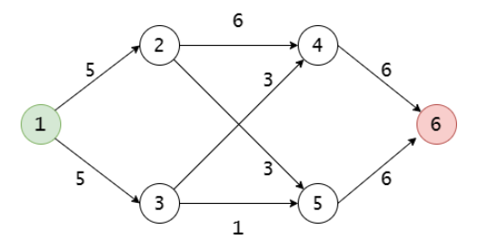
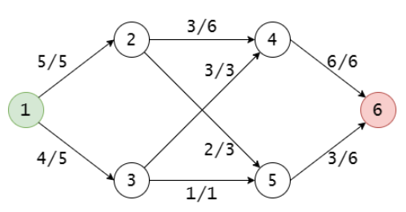
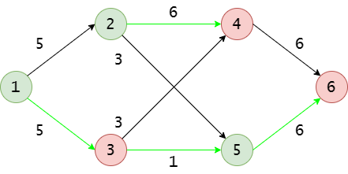
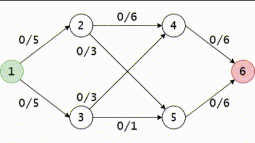

# Max Flow

Reference: https://wiki.vnoi.info/vi/algo/graph-theory/flow

## 1. Định nghĩa

<!--Đồ thị thế nào gọi là network-->
<p align="left">
  <br>
</p>

- Một đồ thị G(V, E) được gọi là mạng (network) nếu nó là đồ thị có hướng, trong đó:
    + Tồn tại đỉnh s không có cạnh vào, đỉnh phát/nguồn (source)
    + Tồn tại đỉnh t không có cạnh ra, đỉnh thu/đích (sink)
    + Các cạnh (u, v) có trọng số c(u, v) gọi là khả năng thông qua/dung lượng (capacity) của cạnh

<!--Luồng trên đồ thị là như thế nào-->
<p align="left">
  <br>
</p>

- Một luồng (flow) trên G(V, E) là phép gán mỗi cạnh một số thực f(u,v) thỏa mãn:
    + Giới hạn dung lượng: $`0 \le f(u, v) \le c(u, v)`$
    + Bảo toàn luồng: với mọi đỉnh $`v \ne s, t`$, tổng luồng đi vào v = tổng luồng đi ra khỏi v
    + f(u, v): luồng trên cạnh (u, v)
    + Giá trị của luồng |f| = Tổng luồng đi ra khỏi s = Tổng luồng đi vào t

<!--Định nghĩa lát cắt (A, B) trên mạng-->
<p align="left">
  <br>
</p>

- Một lát cắt (cut) (A, B) trên mạng là cách chia tập đỉnh V thành 2 tập A, B (mỗi đỉnh thuộc đúng 1 tập) sao cho $`s \in A, t \in B`$:
    + Khả năng thông qua của lát cắt (cut capacity) = tổng dung lượng các cạnh đi **từ A sang B**: $`c(A, B) = \sum\limits_{u \in A, v \in B} c(u, v)`$
    + Chỉ tính cạnh chiều A → B, **không** tính cạnh chiều B → A
    + Ý nghĩa: xóa hết các cạnh A → B thì không còn đường nào đi từ s đến t
    + Lát cắt hẹp nhất (min cut): lát cắt có c(A, B) nhỏ nhất
- VD (mạng hình 1): A = {1, 2, 5}, B = {3, 4, 6}
    + Cạnh A → B: (1, 3), (2, 4), (5, 6) ⇒ c(A, B) = 5 + 6 + 6 = 17

## 2. Phương pháp Ford-Fulkerson. Thuật toán Edmonds-Karp

<details>
<summary>
<b>Lịch sử thuật toán</b>
</summary>
<p>
    Năm 1956, L. R. Ford Jr. và D. R. Fulkerson đề xuất một phương pháp để tìm ra luồng cực đại trên mạng. Tuy nhiên, phương pháp này không chỉ rõ việc tìm đường tăng luồng như thế nào. 
</p>
<p>
    Đến năm 1972, Jack Edmonds và Richard Karp đã hoàn thiện phương pháp trên bằng cách sử dụng thuật BFS để tìm đường tăng luồng.
</p>

<p>
    Nhiều tài liệu sử dụng cụm từ "thuật toán Ford-Fulkerson" để gọi thuật tìm luồng cực đại hoàn chỉnh, và biến "thuật toán Edmonds-Karp" thành một thuật xa lạ kì quặc nào đó. Điều này có lẽ cũng ... không hẳn là sai. Bài viết này sẽ sử dụng tên Edmonds-Karp cho thuật toán, và chỉ gọi là "phương pháp Ford-Fulkerson" thôi. Bạn đọc muốn hiểu theo cách nào cũng được.
</p>
</details>

### Khái niệm

- Với mỗi cạnh (u, v), thêm một cạnh ngược (v, u) với:
    + $`c(v, u) = 0`$ (cạnh ngược không có dung lượng)
    + $`f(v, u) = -f(u, v)`$ (luồng âm)
- Luồng thặng dư (residual flow) = lượng còn có thể đẩy thêm qua cạnh:
    + Cạnh xuôi: $`r(u, v) = c(u, v) - f(u, v)`$ ⇒ còn **tăng** được bao nhiêu
    + Cạnh ngược: $`r(v, u) = 0 - f(v, u) = f(u, v)`$ ⇒ còn **giảm** (trả lại) được bao nhiêu
- Đường tăng luồng (augmenting path): đường đi đơn s → t trên đồ thị thặng dư
    + Đồ thị thặng dư (residual network): gồm mọi cạnh xuôi lẫn ngược có r > 0
    + Trên đồ thị gốc: đường đi đơn (có thể đi ngược chiều cạnh) qua các cạnh có r > 0
- Ý nghĩa cạnh ngược: cho phép "rút lại" luồng đã đẩy trước đó để chuyển sang hướng khác ⇒ sửa được các lựa chọn sai

### Thuật toán

<p align="left">
  <br>
</p>

1. Gán f(u, v) = 0 với mọi cạnh
2. Tìm một đường tăng luồng P từ s đến t
3. $`\Delta = \min_{(u, v) \in P} r(u, v)`$, với mỗi cạnh (u, v) trên P:
    + `f(u, v) += Δ`
    + `f(v, u) -= Δ`
4. Lặp lại bước 2, 3 đến khi không còn đường tăng luồng ⇒ f là luồng cực đại

- Ford-Fulkerson không quy định cách tìm đường cụ thể (có thể dùng DFS, BFS, ... đều được)
- Edmonds-Karp = Ford-Fulkerson + tìm đường bằng BFS (đường ít cạnh nhất)
- VD (Gif phía trên): tăng luồng lần lượt theo các đường:
    + 1 → 2 → 4 → 6: Δ = 5
    + 1 → 3 → 4 → 6: Δ = 1 (r(4, 6) chỉ còn 1)
    + 1 → 3 → 5 → 6: Δ = 1 ⇒ |f| = 7, không còn đường nào chỉ gồm cạnh xuôi
    + 1 → 3 → 4 → 2 → 5 → 6: Δ = 2, đi qua cạnh ngược (4, 2) với r(4, 2) = f(2, 4) = 5
        * Nghĩa là: 4 nhận thêm 2 từ 3 nên bớt 2 từ 2 (f(2, 4): 5 → 3), 2 đẩy phần dư đó sang 5
    + ⇒ |f| = 9, nếu không có cạnh ngược thì sẽ kẹt ở |f| = 7

### Tính đúng đắn

- Ý tưởng: tìm một "trần" chặn trên mọi luồng (lát cắt), rồi chỉ ra khi thuật toán dừng thì luồng chạm đúng trần đó ⇒ không luồng nào lớn hơn được

#### Bổ đề: luồng đi qua mọi lát cắt đều bằng |f|

- Với mọi luồng f và mọi lát cắt (A, B): |f| = (luồng A → B) − (luồng B → A)
- Lý do: s ∈ A, các đỉnh khác của A vào bao nhiêu ra bấy nhiêu ⇒ cả |f| phải đi ra khỏi A. Phần chảy ngược từ B về A rồi lại đi ra bị tính 2 lần nên phải trừ đi
    + Chặt chẽ: cộng (ra − vào) của mọi đỉnh trong A thì được |f| (chỉ s khác 0). Cạnh nằm gọn trong A được +f ở đỉnh đầu, −f ở đỉnh cuối ⇒ triệt tiêu, chỉ còn các cạnh nối A với B
- VD A = {1, 2, 5}: đi A → B là (1, 3) + (2, 4) + (5, 6) = 4 + 3 + 3 = 10, đi B → A là (3, 5) = 1 ⇒ 10 − 1 = 9 = |f|
- VD A = {1}: 5 + 4 = 9 = |f|

#### Định lý 1: mọi luồng ≤ mọi lát cắt

```math
|f| = \sum_{A \to B} f - \sum_{B \to A} f \le \sum_{A \to B} f \le \sum_{A \to B} c = c(A, B)
```

- Dấu ≤ thứ nhất: bỏ phần luồng chảy ngược B → A (luôn ≥ 0). Dấu ≤ thứ hai: f ≤ c trên mỗi cạnh
- Dấu "=" xảy ra ⇔ mọi cạnh A → B đều đầy (f = c) và mọi cạnh B → A đều rỗng (f = 0)
- VD A = {1, 2, 5}: 9 ≤ 17, vì còn luồng chảy ngược (3, 5) và các cạnh A → B chưa đầy
- VD A = {1, 3}: (1, 2), (3, 4), (3, 5) đều đầy, không có cạnh B → A ⇒ |f| = 9 = 5 + 3 + 1 = c(A, B)
- ⇒ Lát cắt nào cũng là chặn trên: không luồng nào trên mạng hình 1 vượt quá 9

#### Định lý 2: khi không còn đường tăng luồng thì f là luồng cực đại

- Gọi A = các đỉnh đi tới được từ s trên đồ thị thặng dư (chỉ đi cạnh r > 0), B = phần còn lại
    + Hết đường tăng luồng ⇒ không tới được t ⇒ t ∈ B ⇒ (A, B) là lát cắt
- Cạnh u → v với u ∈ A, v ∈ B phải đầy: nếu r = c − f > 0 thì đi tới được v ⇒ v ∈ A, vô lý
- Cạnh u → v với u ∈ B, v ∈ A phải rỗng: nếu f > 0 thì cạnh ngược v → u có r = f > 0 ⇒ đi tới được u ⇒ u ∈ A, vô lý
- ⇒ Đúng điều kiện dấu "=" ở Định lý 1 ⇒ |f| = c(A, B), luồng đã chạm trần ⇒ f cực đại
- VD (luồng hình 2): từ 1 chỉ đi được sang 3 vì (1, 2) đầy, từ 3 thì (3, 4), (3, 5) đều đầy ⇒ A = {1, 3}, c(A, B) = 9 = |f|
- VD vì sao cần cạnh ngược, lúc |f| = 7 (sau 3 đường đầu trong GIF):
    + Chỉ đi cạnh xuôi thì kẹt ở A = {1, 3, 4}, nhưng cạnh (2, 4) đi B → A còn f = 5 ≠ 0 ⇒ chưa thỏa điều kiện, c(A, B) = 12 ≠ 7
    + Tính cả cạnh ngược: (4, 2) có r = f(2, 4) = 5 ⇒ đi tiếp 4 → 2 → 5 → 6 ⇒ vẫn còn đường tăng luồng
    + ⇒ Thiếu cạnh ngược thì thuật toán dừng sớm ở 7 và Định lý 2 không còn đúng

#### Hệ quả

- Max-flow Min-cut: luồng cực đại = khả năng thông qua của lát cắt hẹp nhất (VD: 9 = c({1, 3}))
- Tìm min cut: chạy xong thuật toán, các đỉnh đi tới được từ s (qua cạnh r > 0) chính là tập A
    + Các cạnh A → B là "cổ chai" của mạng: muốn tăng luồng cực đại thì phải tăng dung lượng các cạnh này
    + VD: c(3, 5) từ 1 lên 2 ⇒ luồng cực đại 9 → 10. c(2, 4) từ 6 lên 10 (không thuộc min cut) ⇒ vẫn 9
- Mọi c nguyên ⇒ mỗi Δ đều nguyên ⇒ luồng cực đại nguyên (VD các Δ lần lượt là 5, 1, 1, 2)

### Cài đặt (Edmonds-Karp)

#### Bản VNOI (ma trận)

- Lưu bằng ma trận: `c[u][v]` là dung lượng, `f[u][v]` là luồng
    + Cạnh ngược (v, u) dùng luôn ô `[v][u]`: `c[v][u] = 0`, `f[v][u] = -f[u][v]` ⇒ r(v, u) = 0 − f[v][u] = f[u][v]
    + `adj[u]` lưu cả v lẫn u (2 chiều) để BFS đi được qua cạnh ngược
    + Có nhiều cạnh (u, v) thì cộng dồn `c[u][v] += w`
- `trace[v]`: đỉnh đứng trước v trên đường BFS (0 = chưa thăm, `trace[s] = -1`) ⇒ lần theo `trace` từ t về s để tìm Δ và tăng luồng
    + Vì 0 là "chưa thăm" nên đỉnh phải đánh số từ 1 (đánh số từ 0 sẽ sai)
- Lần BFS cuối cùng (không tới được t) duyệt đúng tập A của lát cắt hẹp nhất
- Bộ nhớ O(V²) ⇒ chỉ dùng khi V nhỏ (V ≤ khoảng 4000 với giới hạn 256 MB)

```cpp
// vnoi version
struct EdmondsKarp {
    int n;
    vector<vector<int>> adj;    // adj[u]: các đỉnh kề u (kể cả theo cạnh ngược)
    vector<vector<ll>> c, f;    // c[u][v]: dung lượng, f[u][v]: luồng, f[v][u] = -f[u][v]
    vector<int> trace;          // trace[v]: đỉnh đứng trước v trên đường tăng luồng

    EdmondsKarp(int n) : n(n), adj(n + 1), c(n + 1, vector<ll>(n + 1, 0)), f(n + 1, vector<ll>(n + 1, 0)) {}

    void addEdge(int u, int v, ll w) {
        adj[u].push_back(v);
        adj[v].push_back(u);    // lưu thêm cạnh ngược để BFS đi được qua nó
        c[u][v] += w;           // cộng dồn nếu có nhiều cạnh (u, v)
    }

    bool bfs(int s, int t) {
        trace.assign(n + 1, 0);  // 0: chưa thăm
        queue<int> q;
        q.push(s);
        trace[s] = -1;
        while (!q.empty()) {
            int u = q.front(); q.pop();
            for (int v : adj[u]) {
                if (trace[v] || c[u][v] - f[u][v] == 0) continue;   // đã thăm hoặc r = 0
                trace[v] = u;
                q.push(v);
            }
        }
        return trace[t] != 0;
    }

    ll maxFlow(int s, int t) {
        ll res = 0;
        while (bfs(s, t)) {
            ll delta = LLONG_MAX;
            for (int v = t; v != s; v = trace[v]) {
                int u = trace[v];
                delta = min(delta, c[u][v] - f[u][v]);
            }
            for (int v = t; v != s; v = trace[v]) {
                int u = trace[v];
                f[u][v] += delta;
                f[v][u] -= delta;
            }
            res += delta;
        }
        return res;
    }

    bool inA(int u) { return trace[u] != 0; }
};
```

#### Bản tối ưu bộ nhớ (danh sách kề)

- Lưu cạnh ngay trong danh sách kề `g[u]` ⇒ bộ nhớ O(V + E)
    + Mỗi cạnh lưu `v`, `cap`, `flow` (thay cho `c[u][v]`, `f[u][v]`) và `rev` = vị trí cạnh ngược trong `g[v]`
    + Cạnh `e = g[u][i]` (u → v) có cạnh ngược là `g[v][e.rev]` (v → u)
    + Cạnh ngược có `cap = 0`, `flow = -f` ⇒ r = cap − flow = f (giống ô `[v][u]` của bản VNOI)
    + Nhiều cạnh (u, v) được lưu riêng từng cạnh, không cần cộng dồn
- `trace[v]`: đỉnh đứng trước v (giống bản VNOI), thêm `id[v]`: vị trí cạnh `trace[v] → v` trong `g[trace[v]]`
    + Cần `id` vì giữa 2 đỉnh có thể có nhiều cạnh, chỉ biết đỉnh cha thì chưa biết là cạnh nào
    + Dùng −1 làm "chưa thăm" (không dùng 0) ⇒ đánh số đỉnh từ 0 hay 1 đều được
- BFS dừng ngay khi tới t
- Lần BFS cuối cùng (không tới được t) vẫn duyệt hết ⇒ các đỉnh đã thăm chính là tập A của lát cắt hẹp nhất

```cpp
// optimize memory version
struct EdmondsKarp {
    struct Edge {
        int v, rev;             // rev: vị trí cạnh ngược trong g[v]
        ll cap, flow;
    };
    int n;
    vector<vector<Edge>> g;     // g[u]: các cạnh đi ra từ u (kể cả cạnh ngược)
    vector<int> trace, id;      // cạnh trace[v] → v nằm ở g[trace[v]][id[v]]

    EdmondsKarp(int n) : n(n), g(n + 1) {}

    void addEdge(int u, int v, ll c) {
        int iu = g[u].size(), iv = g[v].size() + (u == v);   // u == v (khuyên): cạnh ngược nằm ngay sau cạnh xuôi
        g[u].push_back({v, iv, c, 0});
        g[v].push_back({u, iu, 0, 0});    // cạnh ngược: c = 0
    }

    bool bfs(int s, int t) {
        trace.assign(n + 1, -1);    // -1: chưa thăm
        id.assign(n + 1, -1);
        trace[s] = s;
        queue<int> q; q.push(s);
        while (!q.empty()) {
            int u = q.front(); q.pop();
            for (int i = 0; i < (int)g[u].size(); i++) {
                Edge &e = g[u][i];
                if (trace[e.v] != -1 || e.cap - e.flow == 0) continue;   // đã thăm hoặc r = 0
                trace[e.v] = u;
                id[e.v] = i;
                q.push(e.v);
                if (e.v == t) return true;   // tới t rồi thì dừng sớm
            }
        }
        return trace[t] != -1;
    }

    ll maxFlow(int s, int t) {
        ll res = 0;
        while (bfs(s, t)) {
            ll delta = LLONG_MAX;
            for (int v = t; v != s; v = trace[v]) {
                Edge &e = g[trace[v]][id[v]];
                delta = min(delta, e.cap - e.flow);
            }
            for (int v = t; v != s; v = trace[v]) {
                Edge &e = g[trace[v]][id[v]];
                e.flow += delta;
                g[v][e.rev].flow -= delta;
            }
            res += delta;
        }
        return res;
    }

    // Gọi sau maxFlow: u thuộc tập A (phía s) của lát cắt hẹp nhất
    bool inA(int u) { return trace[u] != -1; }
};
```

#### So sánh

| | Bản VNOI | Bản tối ưu bộ nhớ |
|---|---|---|
| Bộ nhớ | O(V²) ≈ 16·V² byte ⇒ V ≤ ~4000 với giới hạn 256 MB | O(V + E) ≈ 48 byte / cạnh |
| Đánh số đỉnh | Từ 1 | Từ 0 hoặc 1 |
| Tốc độ | Dựng đồ thị mất O(V²), nhanh trên đồ thị dày khi V nhỏ | Nhanh hơn ở hầu hết trường hợp, chỉ chậm hơn trên đồ thị dày phải duyệt gần hết cạnh |
| Khi nào dùng | V nhỏ, cần code ngắn, dễ nhớ | Mặc định, bắt buộc khi V lớn |

### Độ phức tạp

- Mỗi lần tìm đường tăng luồng (BFS/DFS): O(E)
- Ford-Fulkerson (c nguyên): mỗi lần tăng luồng tăng ít nhất 1 ⇒ O(E · |f*|), với |f*| là giá trị luồng cực đại
    + Phụ thuộc vào giá trị luồng chứ không phải kích thước đồ thị ⇒ c lớn thì có thể rất chậm
    + VD xấu cho DFS: s → a, s → b, a → t, b → t đều có c = 10⁹, thêm cạnh a → b có c = 1. DFS có thể đi luân phiên s → a → b → t và s → b → a → t (qua cạnh ngược), mỗi lần chỉ tăng 1 ⇒ 2·10⁹ lần
- Edmonds-Karp (BFS): tối đa O(VE) lần tăng luồng ⇒ O(VE²), không phụ thuộc c
    + Ý chính: khoảng cách (số cạnh) từ s tới mỗi đỉnh trên đồ thị thặng dư không bao giờ giảm, mỗi cạnh chỉ bị đẩy đầy (là cạnh có r nhỏ nhất trên đường) tối đa O(V) lần
- Thực tế chạy nhanh hơn nhiều so với đánh giá

## 3. Thuật toán Dinic

- Edmonds-Karp mỗi lần BFS chỉ tăng luồng trên 1 đường ⇒ Dinic: mỗi lần BFS tăng luồng trên nhiều đường cùng lúc
- Độ phức tạp O(V²E), tốt hơn O(VE²) của Edmonds-Karp (đồ thị dày E ≈ V² thì Edmonds-Karp là O(V⁵), Dinic là O(V⁴))
- Yefim Dinitz (nhiều tài liệu viết là Dinic) đề xuất năm 1970

### Khái niệm

- Vẫn dùng đồ thị thặng dư như phần Ford-Fulkerson: cạnh xuôi r = c − f, cạnh ngược r = f
- Mức (level) d(u): khoảng cách ngắn nhất (số cạnh) từ s tới u trên đồ thị thặng dư, tính bằng BFS
- Đồ thị phân cấp (layered network): chỉ giữ các cạnh (u, v) có r > 0 và d(v) = d(u) + 1
    + Mọi đường s → t trên đồ thị phân cấp đều là đường ngắn nhất
- Luồng cản (blocking flow): luồng trên đồ thị phân cấp sao cho mọi đường s → t trên đồ thị phân cấp đều có ít nhất 1 cạnh đầy (r = 0)
    + Luồng cản chưa chắc là luồng cực đại: vẫn có thể còn đường tăng luồng đi qua cạnh ngược, nhưng đường đó dài hơn nên không nằm trong đồ thị phân cấp hiện tại

### Thuật toán

1. BFS từ s trên đồ thị thặng dư để tính d ⇒ có đồ thị phân cấp. Không tới được t thì dừng
2. Tìm luồng cản: DFS lặp lại từ s, chỉ đi cạnh của đồ thị phân cấp, mỗi lần tới được t thì tăng luồng trên đường đó (giống Ford-Fulkerson), đến khi DFS không tới được t nữa
3. Quay lại bước 1. Mỗi lần lặp bước 1, 2 gọi là 1 pha

- Dinic = BFS (tính mức) + DFS (tìm luồng cản)
- Không cần dựng đồ thị phân cấp riêng: cạnh (u, v) thuộc đồ thị phân cấp ⇔ r(u, v) > 0 và d(v) = d(u) + 1
- Tối ưu `ptr[u]`: trong cùng 1 pha, DFS tại u tiếp tục từ cạnh đang xét dở ở lần DFS trước
    + Cạnh đã bị bỏ qua (đầy, hoặc dẫn vào ngõ cụt) thì trong pha này không dùng lại được nữa ⇒ không cần xét lại
    + Không có tối ưu này thì mỗi pha có thể mất O(E²) thay vì O(VE)
- VD (mạng hình 1):
    + Pha 1: d(1..6) = (0, 1, 1, 2, 2, 3) ⇒ đồ thị phân cấp gồm cả 8 cạnh xuôi
        * 1 → 2 → 4 → 6: Δ = 5
        * 1 → 3 → 4 → 6: Δ = 1 (ở 1, cạnh (1, 2) đã đầy ⇒ `ptr[1]` chuyển sang (1, 3))
        * 1 → 3 → 5 → 6: Δ = 1 (ở 4, cạnh (4, 6) đã đầy ⇒ ngõ cụt, quay lại 3 thử (3, 5))
        * Luồng cản = 7: (1, 2), (4, 6), (3, 5) đầy ⇒ mọi đường s → t trong đồ thị phân cấp đều bị chặn
    + Pha 2: d(1..6) = (0, 3, 1, 2, 4, 5) ⇒ chỉ còn đường 1 → 3 → 4 → 2 → 5 → 6 (qua cạnh ngược (4, 2)): Δ = 2
    + Pha 3: BFS không tới được t ⇒ dừng, |f| = 7 + 2 = 9
    + Cùng 4 đường như VD Edmonds-Karp nhưng chỉ cần 3 lần BFS thay vì 5. d(t) tăng từ 3 lên 5 sau 1 pha

### Tính đúng đắn

- Mỗi lần DFS tới được t chính là 1 lần tăng luồng của Ford-Fulkerson ⇒ f luôn là luồng hợp lệ
- Thuật toán dừng khi BFS không tới được t ⇒ không còn đường tăng luồng trên đồ thị thặng dư ⇒ theo Định lý 2 (phần Ford-Fulkerson), f là luồng cực đại

### Cài đặt (Dinic)

#### Bản VNOI (ma trận)

- Lưu đồ thị giống bản VNOI của Edmonds-Karp: ma trận `c`, `f` và `adj`
- `d[u]`: mức của u (−1 = chưa thăm) ⇒ đánh số đỉnh từ 0 hay 1 đều được (khác `trace` của Edmonds-Karp)
- `ptr[u]`: vị trí cạnh đang xét trong `adj[u]` (code VNOI đặt tên `curVertexId`), đặt lại về 0 ở đầu mỗi pha
- `dfs(u, t, delta)`: delta là r nhỏ nhất trên đường từ s tới u
    + Tới t ⇒ trả về delta, trên đường quay lui tăng luồng cho từng cạnh luôn ⇒ không cần mảng `trace`
    + `got == 0` (cạnh dẫn vào ngõ cụt) ⇒ `ptr[u]++` bỏ qua cạnh này
    + Tìm được đường ⇒ return ngay, **không** `ptr[u]++` vì cạnh này có thể vẫn còn r > 0
- Lần BFS cuối cùng (không tới được t) ⇒ các đỉnh có d ≠ −1 chính là tập A của lát cắt hẹp nhất

```cpp
// vnoi version
struct Dinic {
    int n;
    vector<vector<int>> adj;    // adj[u]: các đỉnh kề u (kể cả theo cạnh ngược)
    vector<vector<ll>> c, f;    // c[u][v]: dung lượng, f[u][v]: luồng, f[v][u] = -f[u][v]
    vector<int> d, ptr;         // d[u]: mức của u, ptr[u]: vị trí cạnh đang xét trong adj[u]

    Dinic(int n) : n(n), adj(n + 1), c(n + 1, vector<ll>(n + 1, 0)), f(n + 1, vector<ll>(n + 1, 0)) {}

    void addEdge(int u, int v, ll w) {
        adj[u].push_back(v);
        adj[v].push_back(u);    // lưu thêm cạnh ngược để BFS/DFS đi được qua nó
        c[u][v] += w;           // cộng dồn nếu có nhiều cạnh (u, v)
    }

    // BFS tính mức d trên đồ thị thặng dư
    bool bfs(int s, int t) {
        d.assign(n + 1, -1);    // -1: chưa thăm
        d[s] = 0;
        queue<int> q; q.push(s);
        while (!q.empty()) {
            int u = q.front(); q.pop();
            for (int v : adj[u]) {
                if (d[v] != -1 || c[u][v] - f[u][v] == 0) continue;   // đã thăm hoặc r = 0
                d[v] = d[u] + 1;
                q.push(v);
            }
        }
        return d[t] != -1;
    }

    // DFS tìm 1 đường s → t trên đồ thị phân cấp, delta: r nhỏ nhất trên đường từ s tới u
    // Trả về lượng luồng tăng được (0 nếu không còn đường)
    ll dfs(int u, int t, ll delta) {
        if (u == t) return delta;
        for (; ptr[u] < (int)adj[u].size(); ptr[u]++) {     // bỏ qua các cạnh đã xét ở lần DFS trước
            int v = adj[u][ptr[u]];
            if (d[v] != d[u] + 1 || c[u][v] - f[u][v] == 0) continue;   // chỉ đi cạnh của đồ thị phân cấp
            ll got = dfs(v, t, min(delta, c[u][v] - f[u][v]));
            if (got == 0) continue;
            f[u][v] += got;
            f[v][u] -= got;
            return got;
        }
        return 0;
    }

    ll maxFlow(int s, int t) {
        ll res = 0;
        while (bfs(s, t)) {
            ptr.assign(n + 1, 0);
            while (ll delta = dfs(s, t, LLONG_MAX)) res += delta;   // tìm luồng cản
        }
        return res;
    }

    // Gọi sau maxFlow: u thuộc tập A (phía s) của lát cắt hẹp nhất
    bool inA(int u) { return d[u] != -1; }
};
```

#### Bản tối ưu bộ nhớ (danh sách kề)

- Lưu đồ thị giống bản tối ưu bộ nhớ của Edmonds-Karp: `g[u]` chứa các cạnh, `rev` trỏ tới cạnh ngược
- BFS, DFS giữ nguyên, chỉ đổi `c[u][v] - f[u][v]` thành `e.cap - e.flow` và `f[v][u] -= got` thành `g[e.v][e.rev].flow -= got`
- So sánh 2 bản giống phần Edmonds-Karp: bản VNOI tốn O(V²) bộ nhớ, bản này chỉ O(V + E)

```cpp
// optimize memory version
struct Dinic {
    struct Edge {
        int v, rev;             // rev: vị trí cạnh ngược trong g[v]
        ll cap, flow;
    };
    int n;
    vector<vector<Edge>> g;     // g[u]: các cạnh đi ra từ u (kể cả cạnh ngược)
    vector<int> d, ptr;         // d[u]: mức của u, ptr[u]: vị trí cạnh đang xét trong g[u]

    Dinic(int n) : n(n), g(n + 1) {}

    void addEdge(int u, int v, ll c) {
        int iu = g[u].size(), iv = g[v].size() + (u == v);   // u == v (khuyên): cạnh ngược nằm ngay sau cạnh xuôi
        g[u].push_back({v, iv, c, 0});
        g[v].push_back({u, iu, 0, 0});    // cạnh ngược: c = 0
    }

    // BFS tính mức d trên đồ thị thặng dư
    bool bfs(int s, int t) {
        d.assign(n + 1, -1);    // -1: chưa thăm
        d[s] = 0;
        queue<int> q; q.push(s);
        while (!q.empty()) {
            int u = q.front(); q.pop();
            for (Edge &e : g[u]) {
                if (d[e.v] != -1 || e.cap - e.flow == 0) continue;   // đã thăm hoặc r = 0
                d[e.v] = d[u] + 1;
                q.push(e.v);
            }
        }
        return d[t] != -1;
    }

    // DFS tìm 1 đường s → t trên đồ thị phân cấp, delta: r nhỏ nhất trên đường từ s tới u
    // Trả về lượng luồng tăng được (0 nếu không còn đường)
    ll dfs(int u, int t, ll delta) {
        if (u == t) return delta;
        for (; ptr[u] < (int)g[u].size(); ptr[u]++) {       // bỏ qua các cạnh đã xét ở lần DFS trước
            Edge &e = g[u][ptr[u]];
            if (d[e.v] != d[u] + 1 || e.cap - e.flow == 0) continue;   // chỉ đi cạnh của đồ thị phân cấp
            ll got = dfs(e.v, t, min(delta, e.cap - e.flow));
            if (got == 0) continue;
            e.flow += got;
            g[e.v][e.rev].flow -= got;
            return got;
        }
        return 0;
    }

    ll maxFlow(int s, int t) {
        ll res = 0;
        while (bfs(s, t)) {
            ptr.assign(n + 1, 0);
            while (ll delta = dfs(s, t, LLONG_MAX)) res += delta;   // tìm luồng cản
        }
        return res;
    }

    // Gọi sau maxFlow: u thuộc tập A (phía s) của lát cắt hẹp nhất
    bool inA(int u) { return d[u] != -1; }
};
```

### Độ phức tạp

- Số pha ≤ V − 1, vì sau mỗi pha d(t) tăng ít nhất 1, mà d(t) ≤ V − 1
    + Ý chính: so với d cũ, mỗi cạnh trong đồ thị thặng dư mới chỉ đi lên tối đa 1 mức (cạnh ngược mới sinh ra còn đi xuống 1 mức)
    + ⇒ Đường s → t dài đúng d(t) thì phải toàn cạnh của đồ thị phân cấp cũ, nhưng các đường đó đã bị luồng cản chặn hết ⇒ d(t) mới > d(t) cũ
- Mỗi pha: BFS O(E) + tìm luồng cản O(VE)
    + Mỗi đường tìm được dài ≤ V và làm đầy ít nhất 1 cạnh ⇒ ≤ E đường ⇒ O(VE)
    + Cạnh dẫn vào ngõ cụt bị `ptr` bỏ qua, mỗi cạnh tối đa 1 lần mỗi pha ⇒ O(E)
- Tổng: O(V²E)
- Mạng đơn vị (mọi c = 1) dạng ghép cặp 2 phía: chỉ O(E√V)
- Thực tế nhanh hơn Edmonds-Karp rất nhiều. VD đồ thị 10 tầng × 100 đỉnh, ~9·10⁴ cạnh: Edmonds-Karp ~0.6–1 s, Dinic ~1–2 ms


### Bài tập

- VNOJ: [NKFLOW](https://oj.vnoi.info/problem/nkflow), [FLOW1](https://oj.vnoi.info/problem/flow1), [BAOVE](https://oj.vnoi.info/problem/baove), [STNODE](https://oj.vnoi.info/problem/stnode), [KWAY](https://oj.vnoi.info/problem/kway), [JOBSET](https://oj.vnoi.info/problem/jobset)
- Codeforces: [Delivery Bears](https://codeforces.com/problemset/problem/653/D), [Soldier and Traveling](https://codeforces.com/contest/546/problem/E), [Array and Operations](https://codeforces.com/contest/498/problem/c), [Red-Blue Graph](https://codeforces.com/contest/1288/problem/f)
- CSES: [Download Speed](https://cses.fi/problemset/task/1694), [Police Chase](https://cses.fi/problemset/task/1695), [School Dance](https://cses.fi/problemset/task/1696)