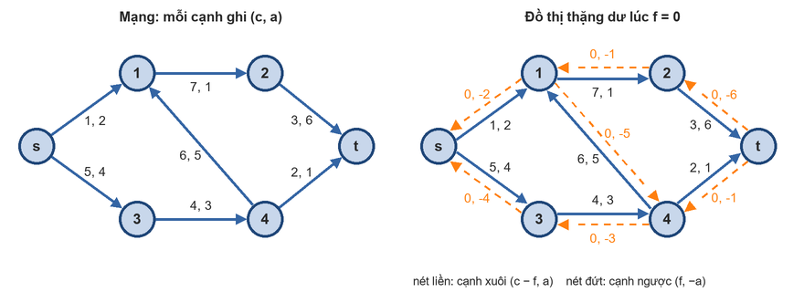
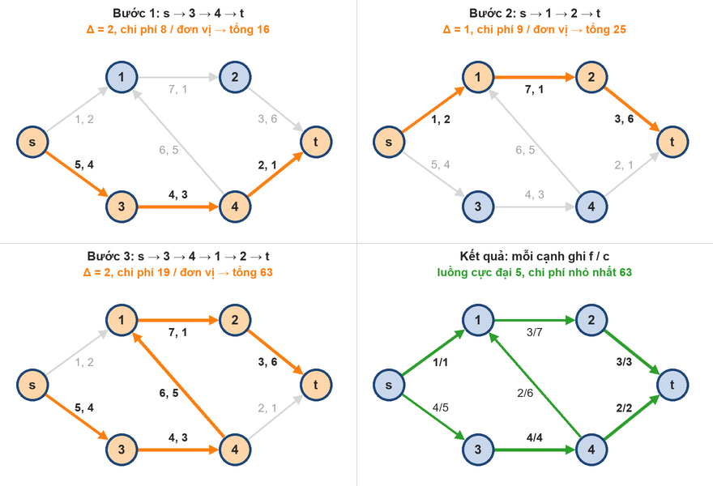

# Min Cost Flow

Reference: https://wiki.vnoi.info/vi/algo/graph-theory/min-cost-flow

Cần biết trước: [MaxFlow.md](MaxFlow.md) (đồ thị thặng dư, đường tăng luồng, Ford-Fulkerson), Bellman-Ford, Dijkstra

## 1. Bài toán

- Mạng giống Max Flow, mỗi cạnh e có thêm **chi phí** a(e): gửi 1 đơn vị luồng qua e tốn a(e)
- Chi phí của luồng f: $`\sum_{e \in E} f(e) \cdot a(e)`$
- Bài toán (min cost max flow): tìm luồng cực đại có chi phí nhỏ nhất
- Biến thể: gửi đúng K đơn vị luồng với chi phí nhỏ nhất
- Thực tế: vận chuyển hàng (mỗi tuyến có sức chứa và cước phí), phân công công việc (mỗi người làm 1 việc, mỗi cặp có chi phí riêng), chọn K đường đi không chung cạnh có tổng độ dài nhỏ nhất, ...

<!--Mạng có chi phí và đồ thị thặng dư ban đầu-->
<p align="left">
  <br>
</p>

- VD (hình trái): mỗi cạnh ghi (c, a) = (sức chứa, chi phí). Luồng cực đại là 5, chi phí nhỏ nhất để gửi 5 đơn vị là 63 (mục 3)

## 2. Đồ thị thặng dư có chi phí

- Giống Max Flow, mỗi cạnh u → v của mạng sinh ra 2 cạnh trong đồ thị thặng dư:
    + Cạnh xuôi u → v: sức chứa c − f, chi phí **a**
    + Cạnh ngược v → u: sức chứa f, chi phí **−a**
- Vì sao cạnh ngược có chi phí −a: đi cạnh ngược là rút lại luồng đã gửi qua u → v ⇒ được hoàn lại chi phí a đã trả
- VD (hình phải): lúc f = 0, mọi cạnh ngược có sức chứa 0 nên chưa đi được
- Hệ quả: đồ thị thặng dư có cạnh chi phí âm ⇒ tìm đường rẻ nhất phải dùng thuật toán chạy được với cạnh âm (Bellman-Ford / SPFA), hoặc Dijkstra kèm thế năng (mục 4)

## 3. Thuật toán: tăng luồng theo đường rẻ nhất

1. Bắt đầu với f = 0
2. Tìm đường đi s → t có **tổng chi phí nhỏ nhất** trên đồ thị thặng dư (chỉ đi cạnh còn sức chứa)
3. Tăng luồng trên đường đó Δ = sức chứa nhỏ nhất trên đường (như Ford-Fulkerson), chi phí tăng Δ × (chi phí của đường)
4. Lặp lại đến khi không còn đường từ s tới t (hoặc đã gửi đủ K đơn vị)

- Chính là Ford-Fulkerson, chỉ khác ở chỗ luôn chọn đường tăng luồng **rẻ nhất** (thay vì đường bất kỳ / ít cạnh nhất). Tên thường gặp: Successive Shortest Path

<!--Các bước tăng luồng trên mạng ví dụ-->
<p align="left">
  <br>
</p>

- VD (hình trên):

| Bước | Đường rẻ nhất | Chi phí 1 đơn vị | Δ | Luồng | Tổng chi phí |
|---|---|---|---|---|---|
| 1 | s → 3 → 4 → t | 4 + 3 + 1 = 8 | 2 (cạnh (4, t) đầy) | 2 | 16 |
| 2 | s → 1 → 2 → t | 2 + 1 + 6 = 9 | 1 (cạnh (s, 1) đầy) | 3 | 25 |
| 3 | s → 3 → 4 → 1 → 2 → t | 4 + 3 + 5 + 1 + 6 = 19 | 2 (cạnh (3, 4), (2, t) đầy) | 5 | 63 |

- Sau bước 3 không còn đường tới t ⇒ luồng cực đại 5, chi phí nhỏ nhất 63
- Chi phí 1 đơn vị không giảm qua các bước (8 → 9 → 19): đường rẻ được dùng trước
- Gửi đúng K đơn vị: dừng khi đủ K, lần cuối chỉ gửi min(Δ, K − đã gửi). VD K = 4: 2 · 8 + 1 · 9 + 1 · 19 = 44

### Tính đúng đắn

- Định lý: luồng f rẻ nhất trong các luồng cùng giá trị ⇔ đồ thị thặng dư của f **không có chu trình chi phí âm**
    + Có chu trình âm ⇒ đẩy thêm luồng quanh chu trình: giá trị luồng không đổi mà chi phí giảm ⇒ f chưa rẻ nhất
    + Không có chu trình âm ⇒ hiệu của f với một luồng cùng giá trị bất kỳ tách được thành các chu trình trên đồ thị thặng dư, chu trình nào cũng có chi phí ≥ 0 ⇒ không luồng nào rẻ hơn f
- Tăng luồng theo đường rẻ nhất giữ được tính chất "không có chu trình âm" sau mỗi bước (chứng minh bằng thế năng ở mục 4) ⇒ sau mỗi bước, luồng hiện tại là luồng rẻ nhất với giá trị của nó ⇒ kết thúc thì được luồng cực đại rẻ nhất
- Điều kiện: mạng ban đầu **không có chu trình chi phí âm** (khi đó f = 0 là luồng rẻ nhất có giá trị 0). Có chu trình âm thì phải khử trước (cycle canceling), ngoài phạm vi note này

## 4. Dijkstra với thế năng (thuật toán Johnson)

- Bellman-Ford / SPFA chạy được với cạnh âm nhưng chậm (O(VE) mỗi lần). Dijkstra nhanh (O(E log V)) nhưng cần mọi cạnh ≥ 0
- Ý tưởng: gán mỗi đỉnh một **thế năng** π(u), đổi chi phí cạnh thành
```math
a'(u, v) = a(u, v) + \pi(u) - \pi(v)
```
- π(u) = khoảng cách ngắn nhất từ s tới u ⇒ a'(u, v) ≥ 0, vì π(v) ≤ π(u) + a(u, v) (bất đẳng thức tam giác)
- Chi phí một đường s → t theo a': các π ở giữa triệt tiêu
```math
\sum a'(p) = \sum a(p) + \pi(s) - \pi(t)
```
- ⇒ Đường rẻ nhất theo a' cũng là đường rẻ nhất theo a, và chi phí thật = d'(t) − π(s) + π(t)
- Cách dùng trong min cost flow:
    1. Lúc đầu: mọi chi phí ≥ 0 thì π = 0, có chi phí âm thì chạy Bellman-Ford 1 lần để tính π
    2. Mỗi lần tăng luồng: Dijkstra theo a' được d'(u), rồi cập nhật π(u) += d'(u) ⇒ π(u) lại bằng khoảng cách thật từ s
    3. Cạnh trên đường vừa tăng luồng có a' = 0 ⇒ cạnh ngược mới sinh ra cũng có a' = 0 ⇒ mọi cạnh vẫn có a' ≥ 0, Dijkstra lần sau vẫn đúng
- Đây cũng là chứng minh cho mục Tính đúng đắn: mọi cạnh thặng dư có a' ≥ 0, mà chi phí một chu trình theo a' bằng chi phí thật (π triệt tiêu hết) ⇒ không có chu trình âm
- VD (mạng hình 1), π ghi theo thứ tự (s, 1, 2, 3, 4, t):
    + Bước 1: π = 0 ⇒ Dijkstra bình thường, d = (0, 2, 3, 4, 7, 8) ⇒ đường s → 3 → 4 → t, π mới = (0, 2, 3, 4, 7, 8)
    + Bước 2: a'(s, 1) = 2 + 0 − 2 = 0, a'(1, 2) = 1 + 2 − 3 = 0, a'(2, t) = 6 + 3 − 8 = 1 ⇒ d'(t) = 1 ⇒ chi phí thật = 1 + π(t) − π(s) = 9
        * Cạnh ngược t → 4 sinh ra ở bước 1 có a' = −1 + 8 − 7 = 0 ≥ 0
    + Bước 3: d'(t) = 10 ⇒ chi phí thật = 10 + 9 = 19, π mới = (0, 12, 13, 4, 7, 19)

### Lỗi trong code mẫu của VNOI

- Hàm `bellmanford` duyệt **mọi** cạnh, kể cả cạnh ngược đang có sức chứa 0 (chi phí −a), tức là các cạnh chưa tồn tại trong đồ thị thặng dư
- Khi mạng có chi phí âm, các cạnh "ảo" này có thể tạo chu trình âm ⇒ π sai ⇒ a' âm ⇒ Dijkstra cho kết quả sai, hoặc mảng truy vết bị vòng nên chương trình chạy mãi không dừng
- VD 4 đỉnh, s = 0, t = 3, cạnh (c, a): 0 → 1 (1, −4), 0 → 2 (1, 5), 1 → 2 (3, −4), 1 → 3 (2, −3), 2 → 3 (1, −3). Đáp án: luồng 2, chi phí −5, code VNOI chạy mãi không dừng
- Thử 20 000 đồ thị không chu trình có chi phí âm: code VNOI sai 8 lần, treo 203 lần
- Sửa: Bellman-Ford chỉ đi cạnh còn sức chứa (c − f > 0) và bỏ qua đỉnh chưa tới được (π = ∞)
- Mọi chi phí ≥ 0 thì code VNOI bỏ qua Bellman-Ford ⇒ không bị lỗi này

## 5. Cài đặt

- Lưu đồ thị giống bản tối ưu bộ nhớ của Dinic: `g[u]` chứa cạnh, `rev` trỏ tới cạnh ngược, mỗi cạnh có thêm `cost`
    + Cạnh ngược: `cap = 0`, `cost = -cost`
- `trace[v]`, `id[v]`: cạnh đi vào v trên đường tìm được (giống Edmonds-Karp) ⇒ lần ngược từ t về s để tìm Δ và tăng luồng
- `minCostFlow(s, t, k)`: gửi tối đa k đơn vị (mặc định: luồng cực đại), trả về {luồng, chi phí}. Luồng trả về < k ⇒ không gửi đủ k được
- Chi phí có thể lên tới (luồng × tổng chi phí trên 1 đường) ⇒ dùng `ll`

### Bản SPFA (dễ hiểu)

- Mỗi lần tìm đường rẻ nhất bằng SPFA (Bellman-Ford dùng hàng đợi), chạy được trực tiếp với cạnh âm, không cần thế năng
- `d[t]` = chi phí 1 đơn vị luồng trên đường vừa tìm

```cpp
// spfa version
struct MinCostFlow {
    struct Edge {
        int v, rev;                 // rev: vị trí cạnh ngược trong g[v]
        ll cap, flow, cost;
    };
    const ll INF = LLONG_MAX / 4;
    int n;
    vector<vector<Edge>> g;
    vector<ll> d;                   // d[u]: chi phí nhỏ nhất từ s tới u trên đồ thị thặng dư
    vector<int> trace, id;          // cạnh trace[v] → v nằm ở g[trace[v]][id[v]]
    vector<bool> inq;

    MinCostFlow(int n) : n(n), g(n + 1) {}

    void addEdge(int u, int v, ll cap, ll cost) {
        int iu = g[u].size(), iv = g[v].size() + (u == v);
        g[u].push_back({v, iv, cap, 0, cost});
        g[v].push_back({u, iu, 0, 0, -cost});      // cạnh ngược: c = 0, chi phí -cost
    }

    // SPFA tìm đường tăng luồng có chi phí nhỏ nhất (chạy được khi có chi phí âm)
    bool spfa(int s, int t) {
        d.assign(n + 1, INF);
        trace.assign(n + 1, -1), id.assign(n + 1, -1), inq.assign(n + 1, false);
        queue<int> q;
        d[s] = 0, q.push(s), inq[s] = true;
        while (!q.empty()) {
            int u = q.front(); q.pop();
            inq[u] = false;
            for (int i = 0; i < (int)g[u].size(); i++) {
                Edge &e = g[u][i];
                if (e.cap - e.flow == 0 || d[u] + e.cost >= d[e.v]) continue;   // hết sức chứa hoặc không tốt hơn
                d[e.v] = d[u] + e.cost;
                trace[e.v] = u, id[e.v] = i;
                if (!inq[e.v]) inq[e.v] = true, q.push(e.v);
            }
        }
        return d[t] < INF;
    }

    // Gửi tối đa k đơn vị luồng từ s tới t với chi phí nhỏ nhất, trả về {luồng, chi phí}
    pair<ll, ll> minCostFlow(int s, int t, ll k = LLONG_MAX) {
        ll flow = 0, cost = 0;
        while (flow < k && spfa(s, t)) {
            ll delta = k - flow;
            for (int v = t; v != s; v = trace[v]) {
                Edge &e = g[trace[v]][id[v]];
                delta = min(delta, e.cap - e.flow);
            }
            for (int v = t; v != s; v = trace[v]) {
                Edge &e = g[trace[v]][id[v]];
                e.flow += delta;
                g[v][e.rev].flow -= delta;
            }
            flow += delta;
            cost += delta * d[t];                   // d[t] = chi phí của 1 đơn vị luồng trên đường này
        }
        return {flow, cost};
    }
};
```

### Bản VNOI (Bellman-Ford 1 lần + Dijkstra với thế năng)

- Cùng ý tưởng với code VNOI, đổi sang cách lưu cạnh như trên và đã sửa lỗi Bellman-Ford
    + `edge[id ^ 1]` của VNOI ⇔ `g[e.v][e.rev]`, `p[v] = {u, id}` của VNOI ⇔ `trace[v]`, `id[v]`
    + Hàm `sendKFlow(k)` của VNOI gộp vào tham số `k` của `minCostFlow`
- `pi`: thế năng, `negCost`: có cạnh chi phí âm thì mới chạy Bellman-Ford
- Dijkstra chỉ đi cạnh còn sức chứa, trọng số `e.cost + pi[u] - pi[e.v]`, xong thì `pi[u] += d[u]` với các đỉnh tới được

```cpp
// vnoi version (dijkstra + thế năng)
struct MinCostFlow {
    struct Edge {
        int v, rev;                 // rev: vị trí cạnh ngược trong g[v]
        ll cap, flow, cost;
    };
    const ll INF = LLONG_MAX / 4;
    int n;
    bool negCost = false;           // có cạnh chi phí âm không
    vector<vector<Edge>> g;
    vector<ll> pi, d;               // pi[u]: thế năng (Johnson), d[u]: khoảng cách theo chi phí đã điều chỉnh
    vector<int> trace, id;          // cạnh trace[v] → v nằm ở g[trace[v]][id[v]]

    MinCostFlow(int n) : n(n), g(n + 1) {}

    void addEdge(int u, int v, ll cap, ll cost) {
        int iu = g[u].size(), iv = g[v].size() + (u == v);
        g[u].push_back({v, iv, cap, 0, cost});
        g[v].push_back({u, iu, 0, 0, -cost});      // cạnh ngược: c = 0, chi phí -cost
        negCost |= cost < 0;
    }

    // Tính pi ban đầu = đường đi ngắn nhất từ s, chỉ đi cạnh còn sức chứa (bỏ cạnh ngược có c = 0)
    void bellmanFord(int s) {
        pi.assign(n + 1, INF);
        pi[s] = 0;
        for (int it = 0; it < n; it++) {
            bool upd = false;
            for (int u = 0; u <= n; u++) {
                if (pi[u] == INF) continue;
                for (Edge &e : g[u])
                    if (e.cap - e.flow > 0 && pi[u] + e.cost < pi[e.v]) pi[e.v] = pi[u] + e.cost, upd = true;
            }
            if (!upd) break;
        }
    }

    // Dijkstra trên chi phí đã điều chỉnh cost + pi[u] - pi[v] (luôn ≥ 0), rồi cập nhật pi
    bool dijkstra(int s, int t) {
        d.assign(n + 1, INF);
        trace.assign(n + 1, -1), id.assign(n + 1, -1);
        priority_queue<pair<ll, int>, vector<pair<ll, int>>, greater<pair<ll, int>>> pq;
        d[s] = 0, pq.push({0, s});
        while (!pq.empty()) {
            auto [du, u] = pq.top(); pq.pop();
            if (du != d[u]) continue;
            for (int i = 0; i < (int)g[u].size(); i++) {
                Edge &e = g[u][i];
                if (e.cap - e.flow == 0) continue;
                ll w = e.cost + pi[u] - pi[e.v];
                if (d[u] + w >= d[e.v]) continue;
                d[e.v] = d[u] + w;
                trace[e.v] = u, id[e.v] = i;
                pq.push({d[e.v], e.v});
            }
        }
        for (int u = 0; u <= n; u++)
            if (d[u] < INF) pi[u] += d[u];          // pi mới = khoảng cách thật từ s
        return d[t] < INF;
    }

    // Gửi tối đa k đơn vị luồng từ s tới t với chi phí nhỏ nhất, trả về {luồng, chi phí}
    pair<ll, ll> minCostFlow(int s, int t, ll k = LLONG_MAX) {
        pi.assign(n + 1, 0);
        if (negCost) bellmanFord(s);
        ll flow = 0, cost = 0;
        while (flow < k && dijkstra(s, t)) {
            ll delta = k - flow, pathCost = 0;
            for (int v = t; v != s; v = trace[v]) {
                Edge &e = g[trace[v]][id[v]];
                delta = min(delta, e.cap - e.flow);
                pathCost += e.cost;
            }
            for (int v = t; v != s; v = trace[v]) {
                Edge &e = g[trace[v]][id[v]];
                e.flow += delta;
                g[v][e.rev].flow -= delta;
            }
            flow += delta;
            cost += delta * pathCost;
        }
        return {flow, cost};
    }
};
```

### Cách dùng

```cpp
// Mạng hình 1: s = 0, các đỉnh 1..4, t = 5
MinCostFlow mcf(6);
mcf.addEdge(0, 1, 1, 2);    // addEdge(u, v, sức chứa, chi phí)
mcf.addEdge(0, 3, 5, 4);
mcf.addEdge(1, 2, 7, 1);
mcf.addEdge(2, 5, 3, 6);
mcf.addEdge(3, 4, 4, 3);
mcf.addEdge(4, 1, 6, 5);
mcf.addEdge(4, 5, 2, 1);
auto [flow, cost] = mcf.minCostFlow(0, 5);         // flow = 5, cost = 63

// Gửi đúng K = 4 đơn vị (dựng lại mạng rồi gọi với k = 4)
// mcf2.minCostFlow(0, 5, 4) trả về flow = 4, cost = 44
```

## 6. Độ phức tạp

- F = luồng cực đại (hoặc K): mỗi lần tăng luồng gửi ít nhất 1 đơn vị (c nguyên) ⇒ tối đa F lần
- Bản SPFA: O(F · V · E) xấu nhất, SPFA thực tế thường nhanh hơn nhiều
- Bản VNOI: O(V · E) cho Bellman-Ford 1 lần + O(F · E log V) cho các lần Dijkstra
- Phụ thuộc vào F chứ không chỉ kích thước đồ thị, nhưng các bài thường có F nhỏ (ghép cặp, K đường đi)
- Đo thực tế (2 bản cho cùng kết quả, mọi chi phí ≥ 0):

| Test | Bản SPFA | Bản VNOI (đã sửa) | Code gốc VNOI |
|---|---|---|---|
| Phân công 300 × 300 (9·10⁴ cạnh, F = 300) | 168 ms | 151 ms | 145 ms |
| Phân công 600 × 600 (3.6·10⁵ cạnh, F = 600) | 2.2 s | 1.3 s | 2.6 s |
| Đồ thị ngẫu nhiên 2000 đỉnh, 2·10⁴ cạnh | 20 ms | 15 ms | 16 ms |

## 7. Lưu ý khi dùng

- Bài phân công: n người, n việc, chi phí cost[i][j]
    + s → người i (c = 1, a = 0), người i → việc j (c = 1, a = cost[i][j]), việc j → t (c = 1, a = 0)
    + Luồng cực đại chi phí nhỏ nhất = cách phân công rẻ nhất, cạnh người → việc có f = 1 là cặp được chọn
- Tìm chi phí **lớn nhất**: đổi dấu chi phí (a → −a) rồi lấy âm kết quả. Chỉ an toàn khi đồ thị không có chu trình (VD đồ thị 2 phía), nếu không sẽ sinh chu trình âm
- K đường đi không chung cạnh, tổng độ dài nhỏ nhất: mỗi cạnh c = 1, a = độ dài, gửi K đơn vị từ s tới t
    + Không chung đỉnh: tách mỗi đỉnh v thành v_in → v_out (c = 1, a = 0)
- Cạnh vô hướng: thêm 2 cạnh có hướng u → v và v → u cùng chi phí (chi phí phải ≥ 0, nếu không 2 cạnh này tạo chu trình âm)

### Bài tập

- VNOJ: [HIWAY](https://oj.vnoi.info/problem/hiway), [HIWAY2](https://oj.vnoi.info/problem/hiway2), [KWAY](https://oj.vnoi.info/problem/kway), [RRDOMINO](https://oj.vnoi.info/problem/rrdomino), [MINCOST](https://oj.vnoi.info/problem/mincost)
- CSES: [Task Assignment](https://cses.fi/problemset/task/2129), [Grid Puzzle II](https://cses.fi/problemset/task/2131)
