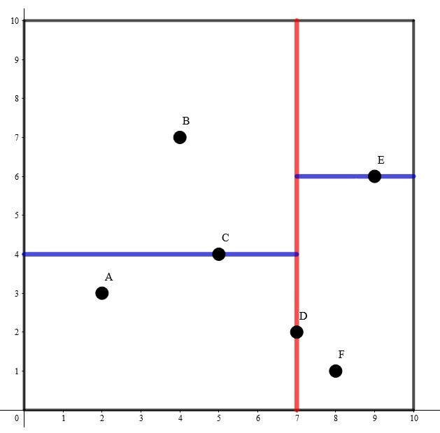
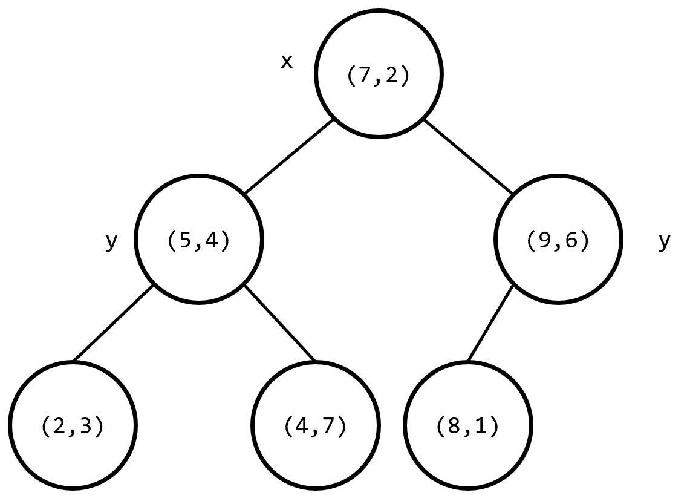
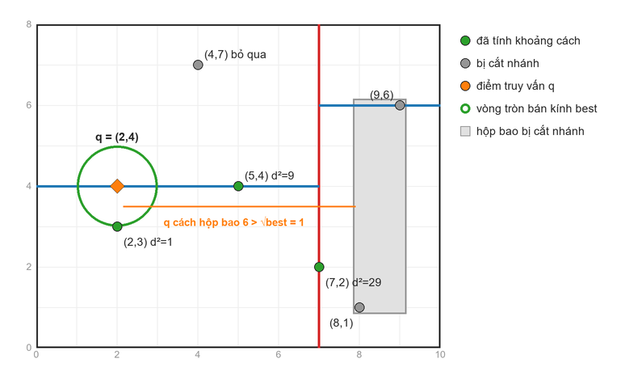
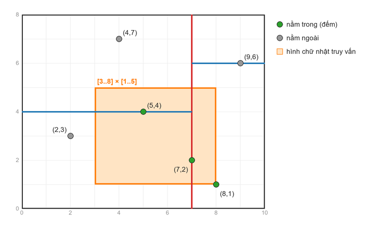

# KD-Tree

Reference:
- https://oi-wiki.org/ds/kdt/ (tiếng Trung, đầy đủ nhất cho lập trình thi đấu)
- https://viblo.asia/p/gioi-thieu-thuat-toan-kd-trees-nearest-neighbour-search-RQqKLvjzl7z
- https://codeforces.com/blog/entry/54080
- https://en.wikipedia.org/wiki/K-d_tree

## 1. Bài toán và định nghĩa

- Bài toán: cho n điểm trong không gian k chiều (thường k = 2 hoặc 3), trả lời nhanh nhiều truy vấn:
    + Tìm điểm gần nhất (nearest neighbor) với một điểm q cho trước
    + Đếm / tính tổng các điểm nằm trong một hình chữ nhật (k chiều thì là hình hộp)
- Vét cạn: O(n) mỗi truy vấn
- 1 chiều: sắp xếp rồi chặt nhị phân (hay cây nhị phân tìm kiếm). KD-tree (k-dimensional tree) mở rộng ý tưởng này lên k chiều
- Jon Bentley đề xuất năm 1975

<!--Cách KD-tree chia mặt phẳng và cây tương ứng-->
<p align="left">
  <br>
</p>

- KD-tree là cây nhị phân, mỗi nút lưu 1 điểm p và 1 trục chia `axis`:
    + Cây con trái: các điểm có tọa độ theo trục `axis` ≤ p[axis]
    + Cây con phải: các điểm có tọa độ theo trục `axis` ≥ p[axis]
    + Hình học: mỗi nút cắt vùng của nó làm 2 bằng đường thẳng (k chiều thì là mặt phẳng) vuông góc với trục `axis` đi qua p
- Hộp bao (bounding box) của nút u: hình chữ nhật nhỏ nhất chứa mọi điểm trong cây con của u, lưu `lo[i]`, `hi[i]` cho từng trục
    + Dùng để cắt nhánh khi truy vấn: biết cả cây con nằm trong hộp nào thì nhiều khi bỏ qua được cả cây con

### Dựng cây

<p align="left">
  <br>
</p>

1. Chọn trục chia: luân phiên theo độ sâu x → y → x → ...
2. Chọn điểm trung vị theo trục đó làm gốc ⇒ 2 nửa có số điểm gần bằng nhau ⇒ cây cân bằng, cao O(log n)
3. Đệ quy dựng cây con trái từ nửa nhỏ hơn, cây con phải từ nửa lớn hơn

- Tìm trung vị bằng `nth_element` O(n) (không cần sort) ⇒ dựng cây O(n log n)
- Biến thể: chọn trục có độ trải (max − min hoặc phương sai) lớn nhất thay vì luân phiên ⇒ chia tốt hơn khi dữ liệu dẹt theo 1 chiều
- VD (hình trên): 6 điểm (2,3), (5,4), (9,6), (4,7), (8,1), (7,2)
    + Gốc chia theo x: x tăng dần là 2, 4, 5, 7, 8, 9 ⇒ trung vị (7,2), đường chia x = 7. Trái {(2,3), (4,7), (5,4)}, phải {(8,1), (9,6)}
    + Nửa trái chia theo y: y = 3, 4, 7 ⇒ trung vị (5,4), đường chia y = 4. Trái (2,3), phải (4,7)
    + Nửa phải chia theo y: y = 1, 6 ⇒ trung vị (9,6), đường chia y = 6. Trái (8,1)

## 2. Tìm điểm gần nhất (nearest neighbor)

### Thuật toán

- Duyệt cây từ gốc, giữ `best` = bình phương khoảng cách nhỏ nhất tìm được tới giờ
- Tại nút u:
    1. Khoảng cách từ q tới hộp bao của u ≥ `best` ⇒ mọi điểm trong cây con đều không gần hơn ⇒ bỏ qua cả cây con (cắt nhánh)
    2. Cập nhật `best` bằng điểm tại u
    3. Đi vào nhánh chứa q trước (q[axis] ≤ p[axis] thì trái), rồi mới tới nhánh còn lại
- Đi nhánh gần trước để sớm có `best` nhỏ ⇒ nhánh xa thường bị cắt
- Hình học: vẽ vòng tròn tâm q bán kính √best, nhánh nào có hộp bao không chạm vòng tròn thì bỏ

<!--Tìm điểm gần nhất với q = (2,4)-->
<p align="left">
  <br>
</p>

- VD (hình trên) q = (2,4):
    + (7,2): d² = 25 + 4 = 29 ⇒ best = 29. q.x = 2 ≤ 7 ⇒ đi trái trước
    + (5,4): d² = 9 ⇒ best = 9. q.y = 4 ≤ 4 ⇒ đi trái trước
    + (2,3): d² = 1 ⇒ best = 1
    + (4,7): hộp bao chỉ là điểm (4,7), d² = 4 + 9 = 13 ≥ 1 ⇒ bỏ qua
    + Quay về gốc, nhánh phải: hộp bao [8..9] × [1..6] cách q một đoạn 8 − 2 = 6 ⇒ 36 ≥ 1 ⇒ bỏ cả nhánh, không xét (9,6), (8,1)
    + ⇒ Điểm gần nhất (2,3), d² = 1. Chỉ phải tính khoảng cách tới 3/6 điểm

### Tính đúng đắn

- Chỉ bỏ cây con khi khoảng cách từ q tới hộp bao ≥ best. Mọi điểm của cây con nằm trong hộp bao ⇒ khoảng cách từ q tới chúng ≥ khoảng cách tới hộp ≥ best ⇒ không bỏ sót điểm nào gần hơn
- Thứ tự duyệt (gần trước, xa sau) chỉ ảnh hưởng tốc độ, không ảnh hưởng kết quả

### Mở rộng

- k điểm gần nhất (k-NN): giữ max-heap k khoảng cách nhỏ nhất, `best` = phần tử lớn nhất của heap (khi heap chưa đủ k thì best = ∞)
- Điểm xa nhất: đảo ngược lại, dùng khoảng cách **xa nhất** từ q tới hộp bao làm cận trên, cắt nhánh khi cận trên ≤ best
- Khoảng cách Manhattan / Chebyshev: chỉ cần đổi công thức khoảng cách điểm – điểm và điểm – hộp

## 3. Đếm điểm trong hình chữ nhật (range query)

### Thuật toán

- Tại nút u, so sánh hộp bao của u với hình chữ nhật truy vấn R:
    + Rời nhau ⇒ trả về 0, bỏ cả cây con
    + Hộp bao nằm trọn trong R ⇒ trả về luôn `sz` (số điểm trong cây con), không cần đi xuống
    + Giao một phần ⇒ kiểm tra điểm tại u, rồi đệ quy 2 con
- Thay `sz` bằng tổng trọng số của cây con ⇒ tính tổng trên hình chữ nhật

<!--Đếm điểm trong hình chữ nhật [3..8] x [1..5]-->
<p align="left">
  <br>
</p>

- VD (hình trên) R = [3..8] × [1..5]:
    + Gốc (7,2): hộp [2..9] × [1..7] giao một phần, (7,2) ∈ R ⇒ +1
    + (5,4): hộp [2..5] × [3..7] giao một phần, (5,4) ∈ R ⇒ +1
        * (2,3): x = 2 < 3 ⇒ rời R, bỏ
        * (4,7): y = 7 > 5 ⇒ rời R, bỏ
    + (9,6): hộp [8..9] × [1..6] giao một phần, (9,6) ∉ R
        * (8,1): hộp nằm trọn trong R ⇒ +sz = +1
    + ⇒ 3 điểm

## 4. Cài đặt

- `t`: mảng các nút, nút u có:
    + `p`: điểm tại nút, `axis`: trục chia, `l`, `r`: chỉ số 2 con (−1 nếu không có)
    + `lo`, `hi`: hộp bao của cây con, `sz`: số điểm trong cây con
- `build(pts, l, r, axis)`: dựng cây cho đoạn `pts[l, r)`, `nth_element` đưa trung vị về vị trí giữa
- `boxDist2(u, q)`: bình phương khoảng cách từ q tới hộp bao của u. Theo mỗi trục, q nằm trong [lo, hi] thì 0, nằm ngoài thì là khoảng cách tới cạnh gần nhất
- `nearest(q)`: bình phương khoảng cách tới điểm gần nhất, `count(a, b)`: số điểm trong hình hộp [a, b]
- `K = 2` là số chiều, đổi `K` để dùng cho 3 chiều trở lên
- Tọa độ ≤ 10⁹ thì bình phương khoảng cách ≤ 8·10¹⁸, vừa `ll` khi K = 2. Tọa độ lớn hơn hoặc K lớn hơn thì dùng `__int128` / `long double`

```cpp
// kd-tree tĩnh: tìm điểm gần nhất, đếm điểm trong hình chữ nhật
struct KDTree {
    static const int K = 2;             // số chiều
    using Point = array<ll, K>;
    struct Node {
        Point p;                        // điểm lưu tại nút
        Point lo, hi;                   // hình hộp bao (bounding box) của cả cây con
        int axis;                       // trục dùng để chia tại nút này
        int l = -1, r = -1;             // con trái, con phải (-1: không có)
        int sz = 1;                     // số điểm trong cây con
    };
    vector<Node> t;
    int root = -1;

    KDTree(vector<Point> pts) { root = build(pts, 0, pts.size(), 0); }

    // Dựng cây cho pts[l, r), chia theo trục axis
    int build(vector<Point> &pts, int l, int r, int axis) {
        if (l >= r) return -1;
        int m = (l + r) / 2;
        nth_element(pts.begin() + l, pts.begin() + m, pts.begin() + r,
                    [&](const Point &a, const Point &b) { return a[axis] < b[axis]; });   // trung vị theo trục axis
        int u = t.size();
        t.push_back({pts[m], pts[m], pts[m], axis});
        int L = build(pts, l, m, (axis + 1) % K);
        int R = build(pts, m + 1, r, (axis + 1) % K);
        t[u].l = L, t[u].r = R;
        for (int c : {L, R}) if (c != -1) {
            t[u].sz += t[c].sz;
            for (int i = 0; i < K; i++) {
                t[u].lo[i] = min(t[u].lo[i], t[c].lo[i]);
                t[u].hi[i] = max(t[u].hi[i], t[c].hi[i]);
            }
        }
        return u;
    }

    static ll dist2(const Point &a, const Point &b) {
        ll d = 0;
        for (int i = 0; i < K; i++) d += (a[i] - b[i]) * (a[i] - b[i]);
        return d;
    }

    // Bình phương khoảng cách nhỏ nhất từ q tới hình hộp bao của nút u (cận dưới cho mọi điểm trong cây con)
    ll boxDist2(int u, const Point &q) {
        ll d = 0;
        for (int i = 0; i < K; i++) {
            ll diff = max({0LL, t[u].lo[i] - q[i], q[i] - t[u].hi[i]});
            d += diff * diff;
        }
        return d;
    }

    void nearest(int u, const Point &q, ll &best) {
        if (u == -1 || boxDist2(u, q) >= best) return;      // cả cây con không thể gần hơn best ⇒ cắt nhánh
        best = min(best, dist2(t[u].p, q));
        int a = t[u].l, b = t[u].r;
        if (q[t[u].axis] > t[u].p[t[u].axis]) swap(a, b);   // đi nhánh chứa q trước
        nearest(a, q, best);
        nearest(b, q, best);
    }

    // Bình phương khoảng cách từ q tới điểm gần nhất (LLONG_MAX nếu cây rỗng)
    ll nearest(const Point &q) {
        ll best = LLONG_MAX;
        nearest(root, q, best);
        return best;
    }

    int count(int u, const Point &a, const Point &b) {
        if (u == -1) return 0;
        bool inside = true;
        for (int i = 0; i < K; i++) {
            if (t[u].hi[i] < a[i] || t[u].lo[i] > b[i]) return 0;    // hộp bao rời hình chữ nhật ⇒ bỏ
            if (t[u].lo[i] < a[i] || t[u].hi[i] > b[i]) inside = false;
        }
        if (inside) return t[u].sz;                                 // hộp bao nằm trọn ⇒ lấy cả cây con
        bool in = true;
        for (int i = 0; i < K; i++) in &= a[i] <= t[u].p[i] && t[u].p[i] <= b[i];
        return in + count(t[u].l, a, b) + count(t[u].r, a, b);
    }

    // Số điểm nằm trong hình hộp [a, b] (a[i] <= x[i] <= b[i] với mọi i)
    int count(const Point &a, const Point &b) { return count(root, a, b); }
};
```

- Cách dùng:

```cpp
vector<KDTree::Point> pts = { {2, 3}, {5, 4}, {9, 6}, {4, 7}, {8, 1}, {7, 2} };
KDTree kd(pts);
kd.nearest({2, 4});         // 1: điểm gần nhất là (2,3), d² = 1
kd.count({3, 1}, {8, 5});   // 3: (5,4), (7,2), (8,1)
```

- Tìm cặp điểm gần nhất: với mỗi điểm truy vấn `nearest` nhưng phải bỏ qua chính nó ⇒ lưu thêm id trong `Node`, bỏ qua nút có id trùng

## 5. Độ phức tạp

- Dựng cây: O(n log n), mỗi tầng `nth_element` tổng O(n), có log n tầng
- Đếm hình chữ nhật: O(√n) với 2 chiều, tổng quát O(n^(1 − 1/k))
    + Chỉ các nút có hộp bao giao một phần với R mới phải đi xuống. Trừ O(log n) nút có hộp chứa cả R, các nút này đều có hộp bị 1 cạnh của R cắt qua
    + Một đường thẳng đứng (cạnh của R): từ nút u đi xuống 2 tầng (1 lần chia x, 1 lần chia y) được 4 vùng con, đường thẳng đứng chỉ cắt tối đa 2 vùng, mỗi vùng còn n/4 điểm ⇒ T(n) = 2T(n/4) + O(1) = O(√n)
    + k chiều: T(n) = 2^(k−1) · T(n/2^k) + O(1) = O(n^(1 − 1/k))
- Tìm điểm gần nhất: trung bình O(log n) khi điểm phân bố đều, nhưng **xấu nhất O(n)**
    + VD xấu: các điểm nằm trên một đường tròn, q ở tâm ⇒ mọi điểm cách q gần bằng nhau ⇒ không cắt được nhánh nào
- Số chiều lớn: chỉ hiệu quả khi n lớn hơn nhiều so với 2^k. Từ khoảng 20 chiều trở lên gần như không nhanh hơn vét cạn

### Đo thực tế

- n = 2·10⁵ điểm ngẫu nhiên, tọa độ ≤ 10⁹, 2·10⁵ truy vấn:

| | KD-tree | Vét cạn |
|---|---|---|
| Dựng cây | 31 ms | – |
| Tìm điểm gần nhất | 68 ms | ~31 s |
| Đếm điểm trong hình chữ nhật ngẫu nhiên | 4.1 s | ~130 s |
| Tìm điểm gần nhất, điểm trên đường tròn, q ở tâm (chỉ 1000 truy vấn) | 2.1 s | 0.17 s |

- Tìm điểm gần nhất trên dữ liệu bình thường: nhanh hơn vét cạn hàng trăm lần
- Đếm hình chữ nhật O(√n) mỗi truy vấn vẫn khá chậm. Làm offline được thì dùng đường quét + BIT O(log n) nhanh hơn nhiều
- Dữ liệu xấu: KD-tree còn chậm hơn vét cạn (vẫn phải thăm gần hết các nút, lại tốn thêm chi phí đệ quy và tính hộp bao)

## 6. Thêm / xóa điểm

- Thêm điểm làm cây mất cân bằng, không xoay cây như BST được (sẽ phá thứ tự trục chia) ⇒ phải dựng lại
- Dựng lại kiểu cây scapegoat: sau khi thêm, cây con nào có con lớn hơn α · sz (α ∈ (0.5, 1), thường 0.7 – 0.75) thì dựng lại cây con đó
    + Thêm: O(log² n) khấu hao
    + Đếm hình chữ nhật xấu nhất O(n^p) với p = (k − 1) / (k − 1 + log₂(1/α)), VD k = 2, α = 0.75 ⇒ p ≈ 0.71, tệ hơn √n
- Dựng lại định kỳ: gom các điểm mới vào 1 danh sách, cứ B lần thêm thì dựng lại cả cây. Lúc truy vấn, các điểm chưa vào cây thì vét cạn
    + Truy vấn O(B + n^(1 − 1/k)), thêm O(n log n / B) khấu hao, chọn B ≈ √(n log n)
- Chia nhóm nhị phân: giữ nhiều cây có kích thước 2^i (giống cộng số nhị phân), thêm 1 điểm thì gộp các cây cùng kích thước rồi dựng lại, truy vấn trên tất cả các cây
    + Thêm O(log² n) khấu hao, truy vấn vẫn O(n^(1 − 1/k)) ⇒ tốt nhất trong 3 cách
- Xóa: đánh dấu đã xóa và trừ `sz`, xóa quá nhiều thì dựng lại

## 7. Ứng dụng thực tế

- Tìm địa điểm gần nhất: cây ATM, quán ăn, trạm sạc gần vị trí hiện tại (tìm điểm gần nhất / k điểm gần nhất trên tọa độ)
- Machine Learning: thuật toán k-NN (phân loại theo k điểm dữ liệu gần nhất)
    + scikit-learn: `KNeighborsClassifier(algorithm="kd_tree")`, `sklearn.neighbors.KDTree`
    + SciPy: `scipy.spatial.KDTree`
- Đám mây điểm 3D (LiDAR trên xe tự lái, máy quét 3D): tìm các điểm lân cận để ước lượng bề mặt, ghép 2 lần quét với nhau. Thư viện PCL có `pcl::KdTreeFLANN`
- Đồ họa máy tính: ray tracing dùng KD-tree để tìm nhanh vật thể mà tia sáng chạm vào (ngày nay BVH phổ biến hơn), photon mapping dùng KD-tree để tìm các photon gần một điểm
- Xử lý ảnh: giảm số màu của ảnh, mỗi pixel tìm màu gần nhất trong bảng màu (không gian RGB 3 chiều)
- Giới hạn: dữ liệu nhiều chiều (embedding của ảnh, văn bản có hàng trăm chiều) thì KD-tree gần như vét cạn ⇒ các hệ thống tìm kiếm vector dùng tìm kiếm gần đúng (ANN) như LSH, HNSW, thư viện FAISS

## 8. Lưu ý khi dùng trong lập trình thi đấu

- Nên dùng KD-tree khi:
    + Tìm điểm gần nhất / xa nhất, nhất là khi có thêm điểm online
    + Đếm / tổng trên hình chữ nhật nhưng bắt buộc online, có cập nhật và giới hạn bộ nhớ chặt (BIT 2D không dùng được)
    + Truy vấn hình dạng lạ, VD nửa mặt phẳng a·x + b·y < c, hoặc 3 – 5 chiều
- Làm offline được thì thường có cách nhanh hơn: đường quét + BIT, chia để trị CDQ, cặp điểm gần nhất bằng chia để trị / đường quét
- KD-tree hay bị đề "bẫy" bằng dữ liệu xấu (điểm trên đường tròn, trên đường thẳng) ⇒ đọc kỹ giới hạn, đo thời gian với test xấu

### Bài tập

- [P1429 平面最近点对](https://www.luogu.com.cn/problem/P1429): cặp điểm gần nhất (so sánh với cách đường quét: https://wiki.vnoi.info/algo/geometry/Sweep-Line)
- [P2479 捉迷藏](https://www.luogu.com.cn/problem/P2479): với mỗi điểm, tìm điểm xa nhất và gần nhất (khoảng cách Manhattan)
- [P4169 天使玩偶](https://www.luogu.com.cn/problem/P4169): thêm điểm, tìm điểm gần nhất theo khoảng cách Manhattan
- [P2093 JZPFAR](https://www.luogu.com.cn/problem/P2093): điểm xa thứ k so với điểm truy vấn
- [LOJ 2043 K 远点对](https://loj.ac/problem/2043): cặp điểm xa thứ K
- [P4390 Mokia](https://www.luogu.com.cn/problem/P4390): cộng giá trị vào điểm, tính tổng trên hình chữ nhật
- [P4148 简单题](https://www.luogu.com.cn/problem/P4148): như Mokia nhưng bắt buộc online, giới hạn bộ nhớ ⇒ thêm điểm + dựng lại cây
- [P4475 巧克力王国](https://www.luogu.com.cn/problem/P4475): tổng h của các điểm thỏa a·x + b·y < c
- [P3769 TATT](https://www.luogu.com.cn/problem/P3769): dãy con dài nhất trên điểm 4 chiều (không giảm theo mọi tọa độ)
