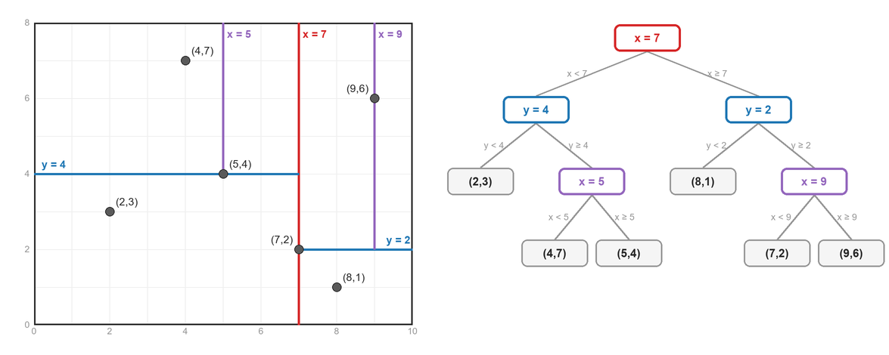
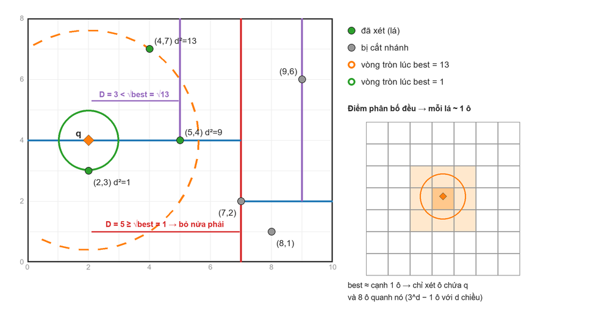
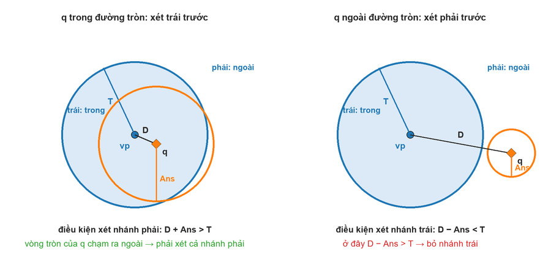

# KD-Tree (theo blog Codeforces)

Reference:
- https://codeforces.com/blog/entry/54080 ([Tutorial] Nearest Neighbor Search: Locality-Sensitive Hashing, K-Dimensional Tree, Vantage-Point Tree, P_Nyagolov, 2017)
- Code của tác giả cho bài SPOJ FAILURE: KD-tree https://ideone.com/yDBOyc, VP-tree https://ideone.com/o1wTNS
- Note KD-tree đầy đủ hơn (hộp bao, đếm hình chữ nhật, dựng lại cây): [KDTree.md](KDTree.md)

## 0. Khác gì so với KDTree.md

| | KDTree.md | Blog này |
|---|---|---|
| Điểm lưu ở đâu | Mọi nút | Chỉ ở lá, nút trong lưu trục chia + giá trị chia |
| Cắt nhánh theo | Khoảng cách tới hộp bao | Khoảng cách tới đường chia |
| Truy vấn | Điểm gần nhất, đếm hình chữ nhật | Điểm gần nhất |
| Thêm / xóa điểm | Dựng lại cây | Tách / gỡ lá, không cân bằng lại |
| Cấu trúc khác | | 1 chiều, LSH, VP-tree |

## 1. Bài toán: tìm điểm gần nhất (Nearest Neighbor Search)

- Cho N điểm d chiều và Q truy vấn, mỗi truy vấn cho điểm q: tìm khoảng cách (Euclid) từ q tới điểm gần nhất trong tập. Có thể có thêm / xóa điểm
- Với d > 1, blog chỉ xét độ phức tạp **trung bình** khi điểm phân bố đều. Ngay cả trung bình thì chi phí cũng tăng theo hàm mũ của d

## 2. Một chiều

- Điểm gần q nhất chỉ có thể là điểm liền trước hoặc liền sau q
- Sắp xếp rồi chặt nhị phân tìm vị trí của q ⇒ O(log N) mỗi truy vấn
- Có thêm / xóa: dùng `std::set` (cây nhị phân tìm kiếm cân bằng), vẫn O(log N)

```cpp
// 1 chiều: khoảng cách từ q tới điểm gần nhất trong s (s khác rỗng)
ll nearest1D(const set<ll> &s, ll q) {
    auto it = s.lower_bound(q);                         // điểm đầu tiên ≥ q
    ll best = LLONG_MAX;
    if (it != s.end()) best = min(best, *it - q);
    if (it != s.begin()) best = min(best, q - *prev(it));
    return best;
}
```

## 3. Locality-Sensitive Hashing (LSH), 2 chiều

- Hashing thường cố tránh va chạm. LSH thì ngược lại: muốn các điểm **gần nhau có cùng mã băm**, điểm xa nhau có mã khác nhau
- Cách trong blog:
    + Vẽ L đường thẳng ngẫu nhiên. Mỗi đường chia mặt phẳng làm 2 nửa ⇒ cho 1 bit 0/1 tùy điểm nằm nửa nào
    + Mã băm của 1 điểm = dãy L bit ⇒ có 2^L nhóm (bucket)
    + Truy vấn q: tính mã của q, chỉ so khoảng cách với các điểm cùng nhóm
    + 1 bộ đường dễ "xui": điểm gần nhất bị 1 đường cắt sang nhóm khác ⇒ dùng K bộ đường độc lập, xét mọi điểm cùng nhóm với q trong ít nhất 1 bộ
- Mỗi nhóm trung bình có N / 2^L điểm ⇒ truy vấn O(K · N / 2^L), chưa tính O(K · L) để tính mã
- Thêm / xóa rất dễ: các đường được chọn từ trước, chỉ cần tính mã của điểm rồi thêm / xóa khỏi nhóm
- Nhược điểm: **không đảm bảo đúng**, chỉ cho kết quả gần đúng ⇒ blog chuyển sang KD-tree
- Thực tế: LSH bằng siêu phẳng ngẫu nhiên (SimHash) được dùng để tìm kiếm gần đúng trên dữ liệu nhiều chiều, đúng chỗ mà KD-tree không còn hiệu quả

## 4. KD-tree (d nhỏ, khoảng tới 5 chiều)

### Dựng cây

- Gốc quản lý cả N điểm: sắp theo x, chia ở giữa ⇒ nửa đầu sang cây con trái, nửa sau sang cây con phải
- Tầng tiếp theo chia theo y, rồi lại x, ... (luân phiên các trục), tới khi còn 1 điểm thì thành lá
- Nút trong lưu trục chia và giá trị chia (`split`), lá lưu điểm
- Trong code: `split` = tọa độ nhỏ nhất của nửa phải ⇒ cây con trái ≤ split ≤ cây con phải. Điểm nằm đúng trên đường chia có thể ở cả 2 bên

<!--KD-tree kiểu blog: điểm chỉ nằm ở lá-->
<p align="left">
  <br>
</p>

- VD 6 điểm (2,3), (5,4), (9,6), (4,7), (8,1), (7,2):
    + Gốc chia theo x: 2, 4, 5 | 7, 8, 9 ⇒ x = 7. Trái {(2,3), (4,7), (5,4)}, phải {(7,2), (8,1), (9,6)}
    + Nửa trái chia theo y: 3 | 4, 7 ⇒ y = 4. Trái: lá (2,3), phải {(4,7), (5,4)} chia tiếp theo x: 4 | 5 ⇒ x = 5
    + Nửa phải chia theo y: 1 | 2, 6 ⇒ y = 2. Trái: lá (8,1), phải {(7,2), (9,6)} chia tiếp theo x: 7 | 9 ⇒ x = 9

### Tìm điểm gần nhất

- `best` = ∞, đệ quy từ gốc:
    + Gặp lá: cập nhật `best` bằng điểm ở lá
    + Nút trong: đi vào nửa chứa q trước (q nằm đúng trên đường chia thì đi bên nào cũng được)
    + Sau đó chỉ đi nửa còn lại nếu vòng tròn tâm q bán kính √best **cắt đường chia**: D < √best với D = |q[axis] − split| là khoảng cách từ q tới đường chia
- Đúng vì: mọi điểm ở nửa kia đều cách q ít nhất D. D ≥ √best thì không điểm nào ở đó gần hơn

<!--Cắt nhánh theo khoảng cách tới đường chia-->
<p align="left">
  <br>
</p>

- VD q = (2,4) (hình trên):
    + Gốc (x = 7): q.x = 2 < 7 ⇒ đi trái trước
    + Nút y = 4: q nằm đúng trên đường chia ⇒ code đi phải trước, tới nút x = 5: q.x = 2 < 5 ⇒ lá (4,7): best = 13
    + Quay lại nút x = 5: D = 5 − 2 = 3 < √13 ⇒ phải xét nửa kia: lá (5,4): best = 9
    + Quay lại nút y = 4: D = 0 < 3 ⇒ xét nửa kia: lá (2,3): best = 1
    + Quay lại gốc: D = 7 − 2 = 5 ≥ √1 ⇒ bỏ cả nửa phải (3 điểm)
    + ⇒ Kết quả d² = 1, chỉ xét 3/6 lá

### Vì sao trung bình ~ O(log N), và vì sao chỉ dùng cho d nhỏ

- Điểm phân bố đều ⇒ N lá chia mặt phẳng thành khoảng √N × √N ô gần bằng nhau (lưới bên phải hình trên)
- Đi xuống tới ô chứa q mất O(log N), lúc này `best` cỡ bằng kích thước 1 ô
- Vòng tròn bán kính √best chỉ chạm ô chứa q và 8 ô xung quanh ⇒ khoảng 9 · O(log N)
- d chiều: số ô xung quanh là 3^d − 1 ⇒ trung bình O(3^d · log N), tăng theo hàm mũ của d ⇒ chỉ dùng khi d nhỏ
- Đây là giải thích trực giác (blog cũng nói không phải chứng minh chặt). Xấu nhất vẫn O(N), VD các điểm nằm trên đường tròn và q ở tâm (xem KDTree.md)

### Thêm / xóa điểm

- Thêm: đi xuống như truy vấn tới lá mà điểm mới sẽ rơi vào, tách lá đó thành 1 nút trong có 2 lá (điểm cũ, điểm mới), chia theo trục của tầng đó
- Xóa: tìm lá chứa điểm rồi gỡ lá. Nút cha chỉ còn 1 con ⇒ đưa con đó lên thay chỗ nút cha
- Blog không cân bằng lại cây ⇒ thêm nhiều điểm thì cây bị lệch (xem số đo ở mục 7). Cần thì dựng lại cây như mục 6 của KDTree.md

## 5. Vantage-Point Tree (VP-tree)

- Thuộc họ ball tree: giống KD-tree nhưng chia bằng **đường tròn** thay vì đường thẳng
- Dựng: chọn ngẫu nhiên 1 điểm làm vantage point (vp), sắp các điểm còn lại theo khoảng cách tới vp, bán kính T = khoảng cách tới điểm ở giữa
    + Nửa gần (trong đường tròn) sang cây con trái, nửa xa sang cây con phải (điểm nằm đúng trên đường tròn ở bên phải cũng được)
- Truy vấn: D = khoảng cách từ q tới vp, cập nhật best bằng vp, Ans = √best
    + D < T (q trong đường tròn): đi trái trước, rồi đi phải nếu D + Ans > T
    + Ngược lại: đi phải trước, rồi đi trái nếu D − Ans < T

<!--Điều kiện cắt nhánh của VP-tree-->
<p align="left">
  <br>
</p>

- Đúng vì bất đẳng thức tam giác:
    + Điểm x ở nhánh phải có |vp − x| ≥ T ⇒ |q − x| ≥ |vp − x| − D ≥ T − D. Muốn gần hơn Ans thì cần T − D < Ans ⇔ D + Ans > T
    + Điểm x ở nhánh trái có |vp − x| ≤ T ⇒ |q − x| ≥ D − |vp − x| ≥ D − T. Muốn gần hơn Ans thì cần D − T < Ans ⇔ D − Ans < T
- Chỉ cần hàm khoảng cách thỏa bất đẳng thức tam giác ⇒ VP-tree dùng được cả khi dữ liệu không phải tọa độ (VD khoảng cách chỉnh sửa giữa 2 xâu), KD-tree thì không
- Phải dùng khoảng cách thật (có căn), không dùng bình phương khoảng cách được, vì bình phương không thỏa bất đẳng thức tam giác

## 6. Cài đặt

### KD-tree theo blog

- `t`: mảng các nút. Lá có `p` (điểm), `id` (chỉ số của điểm). Nút trong có `axis`, `split`, `l`, `r`
- `build`: chia đôi đoạn chỉ số bằng `nth_element` (không cần sort hết), nửa trái `[l, m)`, nửa phải `[m, r)`
- `nearest(q, skip)`: bình phương khoảng cách tới điểm gần nhất, bỏ qua điểm có `id = skip` ⇒ dùng cho bài "mỗi điểm tìm điểm khác gần nó nhất"
- `insert(p)`: tách lá, trả về `id` của điểm mới. `erase(p)`: gỡ 1 lá chứa p (nếu có)
- `d * d`: |d| ≤ 2·10⁹ khi tọa độ ≤ 10⁹ ⇒ vẫn vừa `ll`

```cpp
// kd-tree theo blog: điểm ở lá, cắt nhánh theo đường chia, thêm / xóa điểm
struct KDTree {
    static const int K = 2;             // số chiều
    using Point = array<ll, K>;
    struct Node {
        bool leaf;
        Point p;                        // lá: điểm
        int id;                         // lá: chỉ số của điểm
        int axis;                       // nút trong: trục chia
        ll split;                       // nút trong: giá trị chia, cây con trái ≤ split ≤ cây con phải
        int l = -1, r = -1;
    };
    vector<Node> t;
    int root = -1, cnt = 0;             // cnt: số id đã cấp

    KDTree(const vector<Point> &pts) {
        cnt = pts.size();
        vector<int> idx(cnt);
        iota(idx.begin(), idx.end(), 0);
        if (cnt) root = build(pts, idx, 0, cnt, 0);
    }

    int newLeaf(const Point &p, int id) {
        t.push_back({true, p, id, 0, 0});
        return t.size() - 1;
    }

    // Dựng cây cho idx[l, r), chia theo trục axis
    int build(const vector<Point> &pts, vector<int> &idx, int l, int r, int axis) {
        if (r - l == 1) return newLeaf(pts[idx[l]], idx[l]);
        int m = (l + r) / 2;
        nth_element(idx.begin() + l, idx.begin() + m, idx.begin() + r,
                    [&](int a, int b) { return pts[a][axis] < pts[b][axis]; });
        int u = t.size();
        t.push_back({false, {}, -1, axis, pts[idx[m]][axis]});     // nửa trái idx[l, m), nửa phải idx[m, r)
        int L = build(pts, idx, l, m, (axis + 1) % K);
        int R = build(pts, idx, m, r, (axis + 1) % K);
        t[u].l = L, t[u].r = R;
        return u;
    }

    static ll dist2(const Point &a, const Point &b) {
        ll d = 0;
        for (int i = 0; i < K; i++) d += (a[i] - b[i]) * (a[i] - b[i]);
        return d;
    }

    void nearest(int u, const Point &q, int skip, ll &best) {
        if (t[u].leaf) {
            if (t[u].id != skip) best = min(best, dist2(t[u].p, q));
            return;
        }
        ll d = q[t[u].axis] - t[u].split;          // khoảng cách (có dấu) từ q tới đường chia
        int nearC = d < 0 ? t[u].l : t[u].r, farC = d < 0 ? t[u].r : t[u].l;
        nearest(nearC, q, skip, best);
        if (d * d < best) nearest(farC, q, skip, best);   // vòng tròn tâm q bán kính √best cắt đường chia ⇒ xét nửa kia
    }

    // Bình phương khoảng cách từ q tới điểm gần nhất, bỏ qua điểm có id = skip (LLONG_MAX nếu không có điểm nào)
    ll nearest(const Point &q, int skip = -1) {
        ll best = LLONG_MAX;
        if (root != -1) nearest(root, q, skip, best);
        return best;
    }

    int insert(int u, const Point &p, int id, int axis) {
        if (t[u].leaf) {                            // tách lá thành nút trong có 2 lá: điểm cũ và điểm mới
            Point o = t[u].p;
            int oid = t[u].id, v = t.size();
            bool pLeft = p[axis] < o[axis];
            t.push_back({false, {}, -1, axis, max(p[axis], o[axis])});
            int a = pLeft ? newLeaf(p, id) : newLeaf(o, oid);
            int b = pLeft ? newLeaf(o, oid) : newLeaf(p, id);
            t[v].l = a, t[v].r = b;
            return v;
        }
        int nxt = (t[u].axis + 1) % K;
        if (p[t[u].axis] < t[u].split) { int c = insert(t[u].l, p, id, nxt); t[u].l = c; }
        else { int c = insert(t[u].r, p, id, nxt); t[u].r = c; }
        return u;
    }

    // Thêm điểm p, trả về id của nó
    int insert(const Point &p) {
        int id = cnt++;
        root = root == -1 ? newLeaf(p, id) : insert(root, p, id, 0);
        return id;
    }

    int erase(int u, const Point &p, bool &done) {
        if (u == -1 || done) return u;
        if (t[u].leaf) {
            if (t[u].p != p) return u;
            done = true;
            return -1;                              // gỡ lá này khỏi cây
        }
        ll v = p[t[u].axis];
        if (v <= t[u].split) t[u].l = erase(t[u].l, p, done);  // p bằng split thì có thể nằm ở cả 2 bên
        if (v >= t[u].split) t[u].r = erase(t[u].r, p, done);
        if (t[u].l == -1) return t[u].r;           // còn 1 con thì đưa con đó lên thay nút này
        if (t[u].r == -1) return t[u].l;
        return u;
    }

    // Xóa 1 điểm p (nếu có)
    void erase(const Point &p) {
        bool done = false;
        root = erase(root, p, done);
    }
};
```

### VP-tree

- `T` lưu khoảng cách thật (`sqrtl`). So sánh nới thêm `EPS` để sai số của `sqrt` không làm bỏ sót nhánh (xét thừa thì chậm hơn một chút nhưng vẫn đúng)

```cpp
// vp-tree theo blog
struct VPTree {
    using Point = array<ll, 2>;
    struct Node {
        Point p;                        // vantage point
        long double T = 0;              // bán kính (threshold): trái ở trong đường tròn, phải ở ngoài
        int l = -1, r = -1;
    };
    vector<Node> t;
    vector<Point> pts;
    int root = -1;
    mt19937 rng{2017};

    VPTree(const vector<Point> &p) : pts(p) { root = build(0, pts.size()); }

    static ll dist2(const Point &a, const Point &b) {
        return (a[0] - b[0]) * (a[0] - b[0]) + (a[1] - b[1]) * (a[1] - b[1]);
    }

    // Dựng cây cho pts[l, r)
    int build(int l, int r) {
        if (l >= r) return -1;
        swap(pts[l], pts[l + rng() % (r - l)]);    // chọn ngẫu nhiên vantage point, đưa về đầu đoạn
        Point vp = pts[l];
        int u = t.size();
        t.push_back({vp});
        if (r - l > 1) {
            int m = (l + 1 + r) / 2;
            nth_element(pts.begin() + l + 1, pts.begin() + m, pts.begin() + r,
                        [&](const Point &a, const Point &b) { return dist2(vp, a) < dist2(vp, b); });
            t[u].T = sqrtl(dist2(vp, pts[m]));     // bán kính = khoảng cách tới điểm ở giữa
            int L = build(l + 1, m), R = build(m, r);
            t[u].l = L, t[u].r = R;
        }
        return u;
    }

    void nearest(int u, const Point &q, ll &best) {
        if (u == -1) return;
        best = min(best, dist2(q, t[u].p));
        const long double EPS = 1e-6;              // sai số sqrt: thà xét thừa còn hơn bỏ sót
        long double D = sqrtl(dist2(q, t[u].p)), ans = sqrtl(best), T = t[u].T;
        if (D < T) {                               // q trong đường tròn ⇒ xét trái trước
            nearest(t[u].l, q, best);
            ans = sqrtl(best);
            if (D + ans + EPS >= T) nearest(t[u].r, q, best);
        } else {                                   // q ngoài đường tròn ⇒ xét phải trước
            nearest(t[u].r, q, best);
            ans = sqrtl(best);
            if (D - ans - EPS <= T) nearest(t[u].l, q, best);
        }
    }

    // Bình phương khoảng cách từ q tới điểm gần nhất
    ll nearest(const Point &q) {
        ll best = LLONG_MAX;
        nearest(root, q, best);
        return best;
    }
};
```

### Cách dùng

```cpp
vector<array<ll, 2>> pts = { {2, 3}, {5, 4}, {9, 6}, {4, 7}, {8, 1}, {7, 2} };
KDTree kd(pts);
kd.nearest({2, 4});         // 1: điểm gần nhất là (2,3)
kd.nearest(pts[0], 0);      // 10: điểm khác gần (2,3) nhất là (5,4)
kd.insert({3, 4});          // trả về id = 6
kd.erase({2, 3});
kd.nearest({2, 4});         // 1: giờ điểm gần nhất là (3,4)

VPTree vp(pts);
vp.nearest({2, 4});         // 1

set<ll> s = {1, 5, 9};
nearest1D(s, 7);            // 2
```

## 7. Độ phức tạp và đo thực tế

| Cấu trúc | Dựng | Truy vấn (trung bình) | Thêm / xóa |
|---|---|---|---|
| 1 chiều (sắp xếp / `set`) | O(N log N) | O(log N) | O(log N) |
| LSH (K bộ, mỗi bộ L đường) | O(N · K · L) | O(K · N / 2^L), có thể sai | Dễ |
| KD-tree | O(N log N) | ~ O(3^d · log N) | O(độ sâu), không tự cân bằng |
| VP-tree | O(N log N) | Tương tự KD-tree | Blog không nêu |

- Đo với N = 2·10⁵ điểm ngẫu nhiên, tọa độ ≤ 10⁹, 2·10⁵ truy vấn:

| | Dựng cây | 2·10⁵ truy vấn |
|---|---|---|
| KD-tree theo blog | 46 ms | 78 ms |
| KD-tree hộp bao (KDTree.md) | 31 ms | 69 ms |
| VP-tree | 35 ms | 127 ms |
| Vét cạn | – | ~31 s |

- Bài kiểu FAILURE (mỗi điểm tìm điểm khác gần nhất), N = 2·10⁵: 89 ms
- Thêm lần lượt 2·10⁵ điểm ngẫu nhiên thay vì dựng sẵn: cây sâu 41 (dựng sẵn chỉ 18), truy vấn chậm ~4 lần (306 ms)
- Thêm 2·10⁴ điểm (i, i) tăng dần: điểm mới luôn rơi về bên phải ⇒ cây thành 1 đường thẳng sâu 19 999, thêm mất 2.6 s, truy vấn 1.4 s, đệ quy sâu dễ tràn stack ⇒ phải dựng lại cây

## 8. Bài tập

- [SPOJ FAILURE](https://www.spoj.com/problems/FAILURE/): với mỗi điểm, tìm khoảng cách tới điểm khác gần nó nhất ⇒ `kd.nearest(pts[i], i)`. Blog nhắc bài này còn có lời giải chia để trị O(N log N) (biến thể của bài cặp điểm gần nhất)
- Các bài khác: xem mục Bài tập trong [KDTree.md](KDTree.md)
